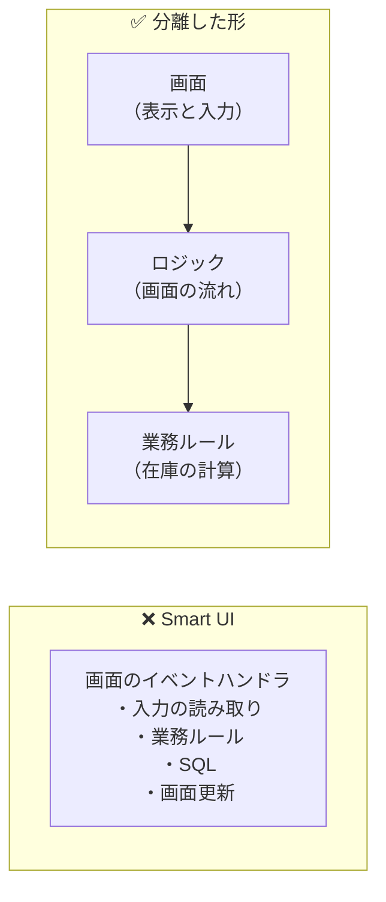

# 第0章 導入：なぜ分けるのか

[目次へ戻る](../../README.md)

## 0.1 この教材のお題：在庫管理アプリ

すべての章で、同じ「在庫管理アプリ」を作ります。同じお題なので、パターンごとの違いだけに注目できます。

**できること**

- 商品の一覧（商品コード・商品名・在庫数・発注点）を表示する
- 商品を選んで **入庫**（在庫を増やす）する
- 商品を選んで **出庫**（在庫を減らす）する
- 在庫数が発注点以下の商品に「要発注」と表示する

**業務ルール**

| ルール | 内容 |
|---|---|
| 数量のルール | 入庫数・出庫数は1以上 |
| 在庫不足のルール | 在庫数より多くは出庫できない |
| 発注のルール | 在庫数 ≦ 発注点 なら「要発注」 |

初期データは次の3件です（第2部の一部の章では4件目を追加します）。

| 商品コード | 商品名 | 在庫数 | 発注点 |
|---|---|---|---|
| P-001 | ボールペン（黒） | 120 | 50 |
| P-002 | A4コピー用紙 | 30 | 40 |
| P-003 | ホッチキス | 15 | 10 |

## 0.2 Bad コード：すべてを画面に書く（Smart UI）

まずはパターンを何も使わずに書いてみます。WinForms で「出庫」ボタンを押したときの処理です。

```csharp
// ❌ Bad: 出庫ボタンのクリックイベントに、すべてを書いている
private void shipButton_Click(object sender, EventArgs e)
{
    // ① 画面から値を読む
    var code = (string)productGrid.CurrentRow.Cells["Code"].Value;
    if (!int.TryParse(quantityTextBox.Text, out var quantity) || quantity <= 0)
    {
        MessageBox.Show("出庫数は1以上で指定してください。");
        return;
    }

    // ② データベースに直接 SQL を投げる
    using var connection = new SqlConnection("Server=prod-db;Database=Inventory;...");
    connection.Open();
    var stock = (int)new SqlCommand(
        $"SELECT Stock FROM Products WHERE Code = '{code}'", connection).ExecuteScalar();

    // ③ 業務ルールの判定
    if (quantity > stock)
    {
        MessageBox.Show($"在庫が不足しています（在庫: {stock}、出庫: {quantity}）。");
        return;
    }

    new SqlCommand(
        $"UPDATE Products SET Stock = Stock - {quantity} WHERE Code = '{code}'", connection).ExecuteNonQuery();

    // ④ 画面を更新
    var newStock = stock - quantity;
    productGrid.CurrentRow.Cells["Stock"].Value = newStock;
    var reorderPoint = (int)productGrid.CurrentRow.Cells["ReorderPoint"].Value;
    productGrid.CurrentRow.Cells["Status"].Value = newStock <= reorderPoint ? "要発注" : "";
    statusLabel.Text = "出庫しました";
}
```

小さなアプリならこれでも動きますし、最初は速く作れます。このような書き方は **Smart UI**（賢すぎる画面）と呼ばれます。
では、アプリが育っていくと何が起きるでしょうか。

## 0.3 何に困るのか

### 問題1：テストできない

「在庫不足のときは出庫できない」というルールが正しく動くか確かめるには、画面を起動し、本物のデータベースにつなぎ、ボタンを押すしかありません。
ルールを1つ変えるたびに、手で画面を操作して確認することになります。

### 問題2：同じルールがあちこちに散らばる

「在庫数 ≦ 発注点なら要発注」という判定は、出庫ボタンのほかに、入庫ボタン、画面の初期表示、帳票の出力にも必要です。
画面に書いていると、それぞれの場所に同じ if 文をコピーすることになり、ルールが変わったときに直し漏れが起きます。

### 問題3：画面を変えると業務ロジックまで壊れる

- WinForms から Web 画面に作り直したい → 業務ルールも SQL も、全部書き直し
- 一覧の列の名前を `"Stock"` から `"在庫数"` に変えた → `Cells["Stock"]` が実行時エラーになる

画面の都合と業務の都合が1か所に混ざっているため、片方の変更がもう片方を壊します。

### 問題4：1つのメソッドが何をしているのか読み取りにくい

①入力の読み取り、②データベース操作、③業務ルール、④画面更新という性質の違う処理が、1つのメソッドに混ざっています。
どこを直せばよいのか見つけるのに時間がかかります。

（ほかに、SQL を文字列連結で組み立てているので SQL インジェクションの危険もありますが、これはアーキテクチャとは別の問題です。）

## 0.4 解決の考え方：関心の分離

これらの問題の原因は、**性質の違う処理が1か所に混ざっていること** です。
そこで、処理をその性質（関心）ごとに分けます。これを **関心の分離（Separation of Concerns）** といいます。



第1部の5つのパターンは、どれも「画面」と「それ以外」をどう分けるか、という問いへの答えです。違いは **画面とロジックをどうやってつなぐか** にあります。

| 章 | パターン | 画面とロジックのつなぎ方 |
|---|---|---|
| 第1章 | MVC | Controller がリクエストを受けて、表示する View を選ぶ |
| 第2章 | MVP | Presenter がインターフェース越しに View を直接操作する |
| 第3章 | MVVM | データバインディングで、ViewModel の状態が自動で画面に反映される |
| 第4章 | MVU | 状態を変更不可にし、「メッセージ → 新しい状態 → 画面」と一方向に流す |
| 第5章 | Flux / Redux | アプリ全体の状態を1つの Store にまとめ、Action でだけ変更する |

そして第2部では、画面より奥の部分（業務ルールやデータベース）をどう分けるかを学びます。

## 0.5 各章の読み方

各章は次の流れで進みます。

1. **Bad コード** … そのパターンを使わないとどうなるか
2. **なぜこの仕組みにしたのか** … Bad コードの問題をどう解決するか
3. **構造** … 登場する部品と、依存の向き
4. **サンプルコードの解説** … `samples/` のコードを読む
5. **メリット・デメリットと向いている場面**

---

[次の章：第1章 MVC →](01-mvc.md)
