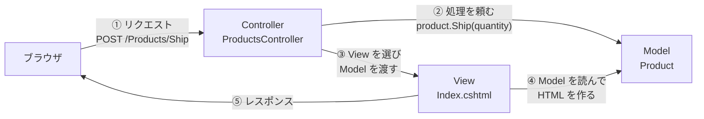

# 第1章 MVC（Model-View-Controller）

[目次へ戻る](../../README.md) ｜ サンプル: [`samples/Part1/01-Mvc`](../../samples/Part1/01-Mvc/Inventory.Mvc)

## 1.1 MVC とは

MVC は、アプリを次の3つの役割に分けるパターンです。1970年代末に Smalltalk で生まれた、UI パターンの元祖です。
現在の C# では **ASP.NET Core MVC**（Web アプリ）が代表的な使われ方です。

| 役割 | 担当すること | 在庫管理アプリでは |
|---|---|---|
| **Model** | データと業務ルール | 商品、在庫の増減、在庫不足のチェック |
| **View** | 表示 | 在庫一覧の HTML |
| **Controller** | 入力を受け取り、Model に処理を頼み、表示する View を選ぶ | 「入庫」「出庫」のリクエストを受ける |

## 1.2 Bad コード：Fat Controller

ASP.NET Core MVC を使っても、「Controller」というクラスを作っただけでは MVC になりません。
よくある失敗は、Controller に何もかも書いてしまう **Fat Controller**（太った Controller）です。

```csharp
// ❌ Bad: Controller が業務ルールも SQL も全部抱えている
public class ProductsController : Controller
{
    [HttpPost]
    public IActionResult Ship(string code, int quantity)
    {
        if (quantity <= 0)
        {
            TempData["Error"] = "出庫数は1以上で指定してください。";
            return RedirectToAction("Index");
        }

        using var connection = new SqlConnection(_connectionString);
        connection.Open();
        var stock = connection.ExecuteScalar<int>(
            "SELECT Stock FROM Products WHERE Code = @code", new { code });

        if (quantity > stock)  // ← 業務ルールが Controller にある
        {
            TempData["Error"] = $"在庫が不足しています（在庫: {stock}、出庫: {quantity}）。";
            return RedirectToAction("Index");
        }

        connection.Execute(
            "UPDATE Products SET Stock = Stock - @quantity WHERE Code = @code", new { code, quantity });
        return RedirectToAction("Index");
    }

    // Receive（入庫）にも、ほぼ同じコードがもう1つある…
}
```

View の側にも、判定が入り込みがちです。

```cshtml
@* ❌ Bad: View の中で業務ルールを判定している *@
<td>@(product.Stock <= product.ReorderPoint ? "要発注" : "")</td>
```

### 何に困るのか

- **業務ルールが HTTP の処理と混ざる**: 「在庫不足なら出庫できない」を確かめるには、HTTP リクエストを組み立てて Controller を呼ぶ必要があります。
- **ルールが再利用できない**: 同じルールを、バッチ処理や別の画面（たとえば Web API）でも使いたくなったとき、Controller からは取り出せません。
- **「要発注」の判定が View に書かれている**: 別の画面で同じ判定をするとコピーが増え、ルールが変わったときに直し漏れが起きます。

## 1.3 なぜこの仕組みにしたのか

MVC の考え方は、**業務ルールを Model に集め、Controller と View は Model を「使うだけ」にする** ことです。

- 在庫不足のチェックを `Product.Ship()` の中に書けば、Controller からでもバッチからでも同じルールが使われます。
- 「要発注」の判定を `Product.NeedsReorder` プロパティにすれば、View は値を表示するだけになります。
- Controller は「どの Model を呼び、どの View を返すか」という **交通整理** だけを担当します。

つまり MVC のポイントは「3つに分けること」そのものより、**Model が画面のことを何も知らない** 状態にすることです。

## 1.4 構造



依存の向きに注目してください。Controller と View は Model を知っていますが、**Model は Controller も View も知りません**。

## 1.5 サンプルコードの解説

```
Inventory.Mvc/
├── Program.cs                      ルーティングと DI の設定
├── Models/
│   ├── Product.cs                  商品と業務ルール（Model）
│   └── ProductRepository.cs        商品の保管場所
├── Controllers/
│   └── ProductsController.cs       入力の受付（Controller）
└── Views/
    └── Products/Index.cshtml       在庫一覧の表示（View）
```

### Model：業務ルールを持つ

[`Models/Product.cs`](../../samples/Part1/01-Mvc/Inventory.Mvc/Models/Product.cs)

```csharp
public class Product(string code, string name, int stock, int reorderPoint)
{
    public int Stock { get; private set; } = stock;   // 外から直接書き換えられない
    public bool NeedsReorder => Stock <= ReorderPoint; // 「要発注」の判定はここだけ

    public void Ship(int quantity)
    {
        if (quantity <= 0)
            throw new InventoryException("出庫数は1以上で指定してください。");
        if (quantity > Stock)
            throw new InventoryException($"在庫が不足しています（在庫: {Stock}、出庫: {quantity}）。");
        Stock -= quantity;
    }
}
```

- `Stock` の setter を `private` にしているので、在庫数を変えるには `Receive()` か `Ship()` を通るしかありません。ルールを迂回できないようにするためです。
- ルール違反は例外 `InventoryException` で知らせます。Model は「エラーを画面にどう表示するか」を知りません。

### Controller：交通整理だけをする

[`Controllers/ProductsController.cs`](../../samples/Part1/01-Mvc/Inventory.Mvc/Controllers/ProductsController.cs)

```csharp
public class ProductsController(IProductRepository repository) : Controller
{
    public IActionResult Index() => View(repository.GetAll());

    [HttpPost]
    [ValidateAntiForgeryToken]
    public IActionResult Ship(string code, int quantity) =>
        Execute(code, product => product.Ship(quantity), $"{quantity}個出庫しました。");

    private IActionResult Execute(string code, Action<Product> operation, string successMessage)
    {
        var product = repository.FindByCode(code);
        if (product is null) return NotFound();
        try
        {
            operation(product);
            TempData["Message"] = $"{product.Name}: {successMessage}";
        }
        catch (InventoryException ex)
        {
            TempData["Error"] = ex.Message;
        }
        return RedirectToAction(nameof(Index));
    }
}
```

- Bad コードと比べると、在庫数の比較（`quantity > stock`）が Controller から消えています。
- Controller がしているのは、①商品を探す、②Model に処理を頼む、③結果のメッセージを用意する、④一覧へ戻す、の4つだけです。
- POST の後に `RedirectToAction` で一覧へ移動させています。これは **PRG（Post-Redirect-Get）パターン** と呼ばれ、ブラウザの再読み込みで出庫が二重に実行されるのを防ぎます。

### View：表示するだけ

[`Views/Products/Index.cshtml`](../../samples/Part1/01-Mvc/Inventory.Mvc/Views/Products/Index.cshtml)

```cshtml
@model IReadOnlyList<Product>
...
<td class="reorder">@(product.NeedsReorder ? "要発注" : "")</td>
```

`Stock <= ReorderPoint` という判定は書かず、Model の `NeedsReorder` を読むだけにしています。
`true` / `false` を「要発注」という文字にするのは表示の都合なので、View の仕事です。

### 動かしてみる

```bash
dotnet run --project samples/Part1/01-Mvc/Inventory.Mvc
```

表示された URL（例: `http://localhost:5000`）をブラウザで開きます。
P-003（在庫15）で 999 個出庫すると、在庫不足のエラーが表示されます。

## 1.6 メリット・デメリットと向いている場面

| メリット | デメリット |
|---|---|
| 業務ルールが Model に集まり、再利用できる | Controller が太りやすい（何を Controller に書いてよいかの線引きが人によってぶれる） |
| ASP.NET Core に標準で用意されていて情報が多い | Model に業務ルールを書くと、Model が大きくなりやすい（→ 第2部で整理する） |
| URL と処理の対応が分かりやすい | デスクトップアプリのような「画面が状態を持ち続ける」UI には合いにくい |

**向いている場面**: リクエストごとにページを作って返す Web アプリ（ASP.NET Core MVC、Razor Pages）。

> **補足**: 元々の Smalltalk の MVC では、View が Model の変更を監視して自動で再描画していました。
> Web の MVC では「リクエストが来るたびに View を作り直す」ので、この監視の仕組みはありません。
> 同じ MVC という名前でも、時代や環境によって中身が少し違うことは覚えておくとよいでしょう。

---

[← 前の章：第0章 導入](00-introduction.md) ｜ [次の章：第2章 MVP →](02-mvp.md)
