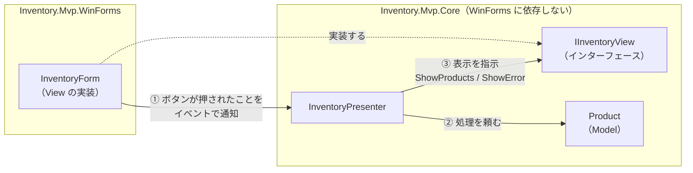

# 第2章 MVP（Model-View-Presenter）

[目次へ戻る](../../README.md) ｜ サンプル: [`samples/Part1/02-Mvp`](../../samples/Part1/02-Mvp)

## 2.1 MVP とは

MVP は MVC から派生したパターンで、Controller の代わりに **Presenter** を置きます。
大きな特徴は、**View をインターフェースにして、Presenter がそのインターフェース越しに View を操作する** ことです。
C# では **WinForms** でよく使われます。

| 役割 | 担当すること |
|---|---|
| **Model** | データと業務ルール（第1章と同じ） |
| **View** | 部品の配置と表示。ボタンが押されたら Presenter に知らせるだけ |
| **Presenter** | 入力のチェック、Model の呼び出し、View への表示指示。画面の処理の流れをすべて持つ |

## 2.2 Bad コード：Model を分けても、フォームに処理の流れが残る

第0章の Smart UI から、業務ルールだけを `Product` クラス（Model）に移したとします。

```csharp
// ❌ Bad: 業務ルールは Model に移したが、処理の流れはフォームに残っている
public partial class InventoryForm : Form
{
    private readonly InMemoryProductRepository _repository = new();

    private void shipButton_Click(object sender, EventArgs e)
    {
        if (productGrid.CurrentRow is null)
        {
            MessageBox.Show("商品を選択してください。");
            return;
        }

        if (!int.TryParse(quantityTextBox.Text, out var quantity))
        {
            MessageBox.Show("数量は整数で入力してください。");
            return;
        }

        var code = (string)productGrid.CurrentRow.Cells["Code"].Value;
        var product = _repository.FindByCode(code)!;
        try
        {
            product.Ship(quantity);  // 業務ルールは Model にある（ここは改善済み）
        }
        catch (InventoryException ex)
        {
            MessageBox.Show(ex.Message);
            return;
        }

        productGrid.DataSource = _repository.GetAll().Select(...).ToList();
        quantityTextBox.Clear();
        statusLabel.Text = $"{product.Name} を {quantity} 個出庫しました。";
    }
}
```

### 何に困るのか

業務ルールは Model に移せましたが、次のような **画面の処理の流れ** がまだフォームにあります。

- 商品が選ばれていなければエラーを出す
- 数量が数字でなければエラーを出す
- 成功したら一覧を更新し、入力欄を空にし、メッセージを出す

これらも立派なロジックで、確かめたいことがたくさんあります（「数字以外を入れたら正しいメッセージが出るか」など）。
しかし、このコードは `Form`・`DataGridView`・`MessageBox` に直接触れているので、**画面を起動しないとテストできません**。
自動テストの中で `MessageBox` が表示されたら、誰かが OK を押すまでテストが止まってしまいます。

## 2.3 なぜこの仕組みにしたのか

MVP では、処理の流れを **Presenter** という別のクラスに移します。
ただし、Presenter が `InventoryForm` を直接使ってしまうと、結局テストで画面が必要になります。

そこで、**Presenter から見た「画面」をインターフェース（`IInventoryView`）として定義** します。

- 本番では、`InventoryForm` が `IInventoryView` を実装する
- テストでは、画面を出さない偽物の `FakeView` が `IInventoryView` を実装する

Presenter はインターフェースしか知らないので、本物の画面か偽物かを区別しません。これで、画面の処理の流れをすべて自動テストで確かめられるようになります。

View には判断を一切させず、Presenter から言われたとおりに表示するだけにします。このやり方を **Passive View**（受け身の View）と呼びます。

## 2.4 構造



MVC との違いは次の2点です。

- **Presenter と View は 1対1** で、Presenter が View を直接操作する（MVC の Controller は View を「選ぶ」だけ）
- **View はインターフェース** なので、差し替えられる

プロジェクトも分けています。`Inventory.Mvp.Core` は WinForms を参照しない普通のクラスライブラリなので、テストプロジェクトから WinForms なしで使えます。

## 2.5 サンプルコードの解説

```
02-Mvp/
├── Inventory.Mvp.Core/               WinForms に依存しない部分
│   ├── Models/Product.cs             Model
│   └── Presenters/
│       ├── IInventoryView.cs         Presenter から見た画面
│       └── InventoryPresenter.cs     Presenter
└── Inventory.Mvp.WinForms/           WinForms の部分
    ├── InventoryForm.cs              View（IInventoryView の実装）
    └── Program.cs                    3つを組み立てて起動
```

### View のインターフェース：画面に「できること」を決める

[`Presenters/IInventoryView.cs`](../../samples/Part1/02-Mvp/Inventory.Mvp.Core/Presenters/IInventoryView.cs)

```csharp
public interface IInventoryView
{
    event EventHandler? ReceiveRequested;   // 入庫ボタンが押された
    event EventHandler? ShipRequested;      // 出庫ボタンが押された

    string? SelectedProductCode { get; }    // 選択中の商品コード
    string QuantityText { get; }            // 数量欄の文字列

    void ShowProducts(IReadOnlyList<ProductRow> rows);
    void ShowMessage(string message);
    void ShowError(string message);
    void ClearQuantity();
}
```

`DataGridView` や `TextBox` といった WinForms の型は1つも出てきません。
「選択中の商品コード」「数量の文字列」のように、**画面の部品ではなく、画面が扱う情報** で定義するのがコツです。

### Presenter：処理の流れをすべて持つ

[`Presenters/InventoryPresenter.cs`](../../samples/Part1/02-Mvp/Inventory.Mvp.Core/Presenters/InventoryPresenter.cs)

```csharp
public InventoryPresenter(IInventoryView view, IProductRepository repository)
{
    _view = view;
    _repository = repository;
    _view.ShipRequested += (_, _) => Execute((product, quantity) => product.Ship(quantity), "出庫");
    ...
}

private void Execute(Action<Product, int> operation, string operationName)
{
    var code = _view.SelectedProductCode;
    if (code is null)
    {
        _view.ShowError("商品を選択してください。");
        return;
    }
    if (!int.TryParse(_view.QuantityText, out var quantity))
    {
        _view.ShowError("数量は整数で入力してください。");
        return;
    }
    ...
    RefreshProducts();
    _view.ClearQuantity();
    _view.ShowMessage($"{product.Name} を {quantity} 個{operationName}しました。");
}
```

Bad コードでフォームにあった処理が、ほぼそのまま移ってきています。違いは、`MessageBox.Show` が `_view.ShowError` に、`productGrid.DataSource = ...` が `_view.ShowProducts` に変わったことです。
**「エラーを表示する」という判断は Presenter がし、「どうやって表示するか（MessageBox にするか）」は View が決める** という分担になっています。

### View：言われたとおりに表示するだけ

[`InventoryForm.cs`](../../samples/Part1/02-Mvp/Inventory.Mvp.WinForms/InventoryForm.cs)

```csharp
public sealed class InventoryForm : Form, IInventoryView
{
    public InventoryForm()
    {
        ...
        _shipButton.Click += (_, _) => ShipRequested?.Invoke(this, EventArgs.Empty);
    }

    public string QuantityText => _quantityTextBox.Text;

    public void ShowError(string message) =>
        MessageBox.Show(this, message, "エラー", MessageBoxButtons.OK, MessageBoxIcon.Warning);
}
```

ボタンのクリックは、イベントで Presenter に知らせるだけです。フォームの中に if 文による判断はありません（一覧更新時に選択行を保つ処理だけは、純粋に表示の都合なので View に置いています）。

> 教材として全体を見渡せるように、このサンプルではデザイナーファイル（`*.Designer.cs`）を使わず、コードで画面を組み立てています。

### 組み立て

[`Program.cs`](../../samples/Part1/02-Mvp/Inventory.Mvp.WinForms/Program.cs)

```csharp
var form = new InventoryForm();
var presenter = new InventoryPresenter(form, new InMemoryProductRepository());
presenter.Initialize();
Application.Run(form);
```

### テスト：画面なしで処理の流れを確かめる

[`Part1.Tests/MvpPresenterTests.cs`](../../samples/Part1/Part1.Tests/MvpPresenterTests.cs)

```csharp
private sealed class FakeView : IInventoryView
{
    public string? SelectedProductCode { get; set; }
    public string QuantityText { get; set; } = "";
    public string? LastError { get; private set; }
    public void ShowError(string message) => LastError = message;   // 表示せずに記録する
    public void ClickShip() => ShipRequested?.Invoke(this, EventArgs.Empty);
    ...
}

[Fact]
public void 数量が数字でないとエラーが表示される()
{
    var (view, _) = CreateSut();
    view.SelectedProductCode = "P-001";
    view.QuantityText = "abc";

    view.ClickReceive();

    Assert.Equal("数量は整数で入力してください。", view.LastError);
}
```

Bad コードでは画面を起動しなければ確かめられなかったことが、一瞬で終わる自動テストになりました。

```bash
dotnet test samples/Part1/Part1.Tests --filter "FullyQualifiedName~MvpPresenterTests"
dotnet run --project samples/Part1/02-Mvp/Inventory.Mvp.WinForms
```

## 2.6 メリット・デメリットと向いている場面

| メリット | デメリット |
|---|---|
| 画面の処理の流れを、画面なしでテストできる | View のインターフェースと、それを呼ぶコードを手で書く量が多い |
| データバインディングの仕組みがない UI 技術でも使える | 画面が複雑になると、インターフェースのメンバーが増え続ける |
| View が単純になり、UI 技術を乗り換えやすい | Presenter が View を細かく操作するため、Presenter が大きくなりやすい |

**向いている場面**: WinForms のような、データバインディングが弱い UI 技術でテストしやすくしたいとき。既存の WinForms アプリを少しずつ整理するときにも使えます。

> **補足：Supervising Controller**
> MVP には、View に簡単なデータバインディングを許す **Supervising Controller** という形もあります。
> 単純な表示はバインディングに任せ、複雑な処理だけ Presenter が担当します。
> このサンプルは、View に判断を一切させない Passive View の形です。

---

[← 前の章：第1章 MVC](01-mvc.md) ｜ [次の章：第3章 MVVM →](03-mvvm.md)
