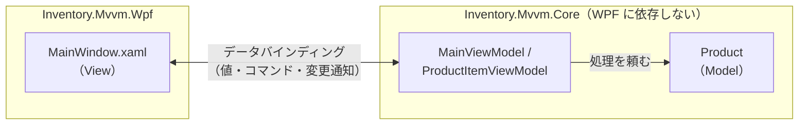

# 第3章 MVVM（Model-View-ViewModel）

[目次へ戻る](../../README.md) ｜ サンプル: [`samples/Part1/03-Mvvm`](../../samples/Part1/03-Mvvm)

## 3.1 MVVM とは

MVVM は、WPF のために Microsoft で考えられたパターンです。
**データバインディング**（画面の部品とプロパティを自動で同期させる仕組み）を使って、View と ViewModel をつなぎます。
C# では **WPF、.NET MAUI、Avalonia、WinUI** などで広く使われています。

| 役割 | 担当すること |
|---|---|
| **Model** | データと業務ルール（第1章と同じ） |
| **View** | XAML で見た目を宣言する。`{Binding ...}` で ViewModel とつながる |
| **ViewModel** | 画面に表示する「状態」と、画面から実行できる「操作（コマンド）」を持つ。**View を知らない** |

## 3.2 Bad コード：コードビハインドにすべて書く

WPF でも、XAML の部品に名前（`x:Name`）を付けて、コードビハインド（`MainWindow.xaml.cs`）から直接操作することはできます。

```csharp
// ❌ Bad: コードビハインドで部品を直接読み書きしている
public partial class MainWindow : Window
{
    private void ShipButton_Click(object sender, RoutedEventArgs e)
    {
        if (ProductGrid.SelectedItem is not Product product) return;
        if (!int.TryParse(QuantityTextBox.Text, out var quantity)) return;

        try
        {
            product.Ship(quantity);
            ProductGrid.Items.Refresh();          // 一覧を手で再描画
            MessageText.Text = "出庫しました";
            MessageText.Foreground = Brushes.DarkGreen;
            QuantityTextBox.Text = "";
        }
        catch (InventoryException ex)
        {
            MessageText.Text = ex.Message;
            MessageText.Foreground = Brushes.Crimson;
        }
    }

    // 「商品が選ばれていて、数量が数字のときだけボタンを押せる」ようにするには…
    private void QuantityTextBox_TextChanged(object sender, TextChangedEventArgs e) => UpdateButtons();
    private void ProductGrid_SelectionChanged(object sender, SelectionChangedEventArgs e) => UpdateButtons();
    private void UpdateButtons()
    {
        var canOperate = ProductGrid.SelectedItem is not null && int.TryParse(QuantityTextBox.Text, out _);
        ReceiveButton.IsEnabled = canOperate;
        ShipButton.IsEnabled = canOperate;
    }
}
```

### 何に困るのか

- **画面の状態を手で同期している**: 値が変わるたびに `Items.Refresh()` を呼んだり、ボタンの `IsEnabled` を更新したりする必要があります。呼び忘れると、画面と中身がずれます。
- **イベントハンドラが増え続ける**: 「ボタンを押せるかどうか」のような1つのルールのために、関係する部品すべてにイベントハンドラが必要です。
- **テストできない**: `ProductGrid` や `QuantityTextBox` は WPF の部品なので、画面なしでは動きません。
- **見た目とロジックが分けられない**: エラー時の文字色（`Brushes.Crimson`）のような見た目の指定がロジックに混ざっていて、デザイナーが XAML だけを触って見た目を変える、ということができません。

## 3.3 なぜこの仕組みにしたのか

第2章の MVP でもテストはできるようになりましたが、Presenter が `ShowProducts()` や `ClearQuantity()` で View を細かく操作する必要がありました。

MVVM では、この「View の操作」を **データバインディングに任せます**。

- ViewModel は「今の数量の文字列」「選択中の商品」「表示するメッセージ」を **プロパティとして持つだけ**
- プロパティの値が変わったら **変更通知（`PropertyChanged` イベント）** を出す
- WPF のデータバインディングが通知を受け取って、画面を自動で更新する

ViewModel は「画面のどこに何があるか」を知る必要がありません。Presenter と違って **View への参照そのものを持たない** ので、View のインターフェースを作る必要もなくなります。

ボタンも同じ考え方です。ViewModel が **コマンド（`ICommand`）** を公開し、ボタンはそれにバインドします。コマンドが「今は実行できない」と答えれば、ボタンは自動で押せなくなります。

## 3.4 構造



矢印の向きに注目してください。**View → ViewModel → Model** の一方向にしか依存していません。ViewModel から View への矢印はありません。

## 3.5 サンプルコードの解説

```
03-Mvvm/
├── Inventory.Mvvm.Core/                   WPF に依存しない部分
│   ├── Models/Product.cs                  Model
│   └── ViewModels/
│       ├── MainViewModel.cs               画面全体の ViewModel
│       └── ProductItemViewModel.cs        一覧の1行分の ViewModel
└── Inventory.Mvvm.Wpf/
    ├── MainWindow.xaml                    View
    └── App.xaml.cs                        ViewModel を View に渡して起動
```

ViewModel の定型コードを減らすために、Microsoft 製のライブラリ **CommunityToolkit.Mvvm** を使っています。

### ViewModel：状態とコマンドを持つ

[`ViewModels/MainViewModel.cs`](../../samples/Part1/03-Mvvm/Inventory.Mvvm.Core/ViewModels/MainViewModel.cs)

```csharp
public partial class MainViewModel : ObservableObject
{
    [ObservableProperty]
    [NotifyCanExecuteChangedFor(nameof(ReceiveCommand))]
    [NotifyCanExecuteChangedFor(nameof(ShipCommand))]
    private string _quantityText = "";

    [ObservableProperty]
    private string _message = "";

    [ObservableProperty]
    private bool _hasError;

    [RelayCommand(CanExecute = nameof(CanOperate))]
    private void Ship() => Execute((item, quantity) => item.Ship(quantity), "出庫");

    private bool CanOperate() => SelectedProduct is not null && int.TryParse(QuantityText, out _);
}
```

属性の意味は次のとおりです。

| 書いたもの | 自動で作られるもの |
|---|---|
| `[ObservableProperty] private string _quantityText;` | 変更通知付きのプロパティ `QuantityText` |
| `[NotifyCanExecuteChangedFor(nameof(ShipCommand))]` | `QuantityText` が変わったら、`ShipCommand` を実行できるか再判定する処理 |
| `[RelayCommand(CanExecute = nameof(CanOperate))] private void Ship()` | ボタンにバインドできる `ShipCommand` プロパティ |

Bad コードの `UpdateButtons()` と2つのイベントハンドラが、`CanOperate()` という1つのメソッドに置き換わりました。
「商品が選ばれていて、数量が数字のときだけ押せる」というルールが1か所にまとまっています。

エラーの扱いにも注目してください。

```csharp
catch (InventoryException ex)
{
    Message = ex.Message;
    HasError = true;   // 「エラーである」という状態を持つだけ。赤字にするのは View の仕事
}
```

`MessageBox` も文字色も出てきません。ViewModel は **状態** を持つだけで、それを **どう見せるか** は View が決めます。

### 一覧の1行分の ViewModel

[`ViewModels/ProductItemViewModel.cs`](../../samples/Part1/03-Mvvm/Inventory.Mvvm.Core/ViewModels/ProductItemViewModel.cs)

```csharp
public partial class ProductItemViewModel(Product product) : ObservableObject
{
    public int Stock => product.Stock;
    public string Status => product.NeedsReorder ? "要発注" : "";

    public void Ship(int quantity)
    {
        product.Ship(quantity);
        OnPropertyChanged(nameof(Stock));
        OnPropertyChanged(nameof(Status));
    }
}
```

Model の `Product` は変更通知を出しません（画面のための仕組みを Model に持ち込まないため）。
そこで、Model を包む ViewModel を作り、在庫が変わったときに `Stock` と `Status` の変更を通知しています。これで Bad コードの `Items.Refresh()` が不要になります。

### View：バインディングを宣言するだけ

[`MainWindow.xaml`](../../samples/Part1/03-Mvvm/Inventory.Mvvm.Wpf/MainWindow.xaml)

```xml
<TextBox Width="80" Text="{Binding QuantityText, UpdateSourceTrigger=PropertyChanged}" />
<Button Content="出庫" Command="{Binding ShipCommand}" />

<TextBlock Text="{Binding Message}">
    <TextBlock.Style>
        <Style TargetType="TextBlock">
            <Setter Property="Foreground" Value="DarkGreen" />
            <Style.Triggers>
                <DataTrigger Binding="{Binding HasError}" Value="True">
                    <Setter Property="Foreground" Value="Crimson" />
                </DataTrigger>
            </Style.Triggers>
        </Style>
    </TextBlock.Style>
</TextBlock>

<DataGrid ItemsSource="{Binding Products}" SelectedItem="{Binding SelectedProduct}" ... />
```

- `UpdateSourceTrigger=PropertyChanged` は「1文字入力するたびに ViewModel へ反映する」という指定です。これにより、入力した瞬間にボタンの押せる/押せないが切り替わります。
- 「エラーなら赤字」という見た目のルールは、`DataTrigger` で XAML の中に書いています。

コードビハインド（[`MainWindow.xaml.cs`](../../samples/Part1/03-Mvvm/Inventory.Mvvm.Wpf/MainWindow.xaml.cs)）には `InitializeComponent()` しかありません。

### View と ViewModel をつなぐ

[`App.xaml.cs`](../../samples/Part1/03-Mvvm/Inventory.Mvvm.Wpf/App.xaml.cs)

```csharp
var window = new MainWindow
{
    DataContext = new MainViewModel(new InMemoryProductRepository()),
};
window.Show();
```

`DataContext` に ViewModel を設定すると、XAML の `{Binding QuantityText}` が `MainViewModel.QuantityText` を指すようになります。

### テスト

[`Part1.Tests/MvvmViewModelTests.cs`](../../samples/Part1/Part1.Tests/MvvmViewModelTests.cs)

```csharp
[Fact]
public void 商品と数量がそろうまでボタンは押せない()
{
    var vm = new MainViewModel(new InMemoryProductRepository());
    Assert.False(vm.ReceiveCommand.CanExecute(null));

    vm.SelectedProduct = vm.Products[0];
    Assert.False(vm.ReceiveCommand.CanExecute(null));

    vm.QuantityText = "5";
    Assert.True(vm.ReceiveCommand.CanExecute(null));
}
```

MVP のテストでは `FakeView` が必要でしたが、MVVM の ViewModel は View を知らないので、**偽物の View すら必要ありません**。プロパティに値を入れて、結果のプロパティを確かめるだけです。

```bash
dotnet test samples/Part1/Part1.Tests --filter "FullyQualifiedName~MvvmViewModelTests"
dotnet run --project samples/Part1/03-Mvvm/Inventory.Mvvm.Wpf
```

## 3.6 メリット・デメリットと向いている場面

| メリット | デメリット |
|---|---|
| 画面の同期を手で書かなくてよい | データバインディングの仕組みを理解するまで、動きが追いにくい |
| ViewModel は View を知らないので、テストが簡単 | バインディングの名前の間違いはコンパイルエラーにならず、実行時に気づく |
| デザイナーとプログラマーが XAML と C# で作業を分けられる | 小さな画面では、ViewModel を用意するのが大げさに感じる |

**向いている場面**: WPF、.NET MAUI、Avalonia、WinUI など、データバインディングが充実した UI 技術。

> **補足：MVP との違いのまとめ**
> | | MVP | MVVM |
> |---|---|---|
> | ロジック側は View を知っているか | インターフェース越しに知っている | 知らない |
> | 画面の更新 | Presenter が `ShowXxx()` を呼ぶ | バインディングが自動で行う |
> | テストに必要なもの | 偽物の View | なし |

---

[← 前の章：第2章 MVP](02-mvp.md) ｜ [次の章：第4章 MVU →](04-mvu.md)
