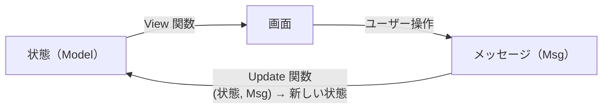
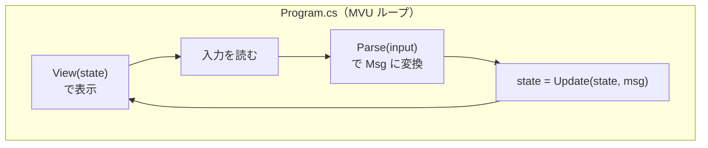

# 第4章 MVU（Model-View-Update / The Elm Architecture）

[目次へ戻る](../../README.md) ｜ サンプル: [`samples/Part1/04-Mvu`](../../samples/Part1/04-Mvu/Inventory.Mvu)

## 4.1 MVU とは

MVU は、関数型言語 Elm で生まれたパターンで、**The Elm Architecture** とも呼ばれます。
C# の世界では、.NET MAUI 向けの MauiReactor や Comet などのライブラリがこの考え方を取り入れています。

| 役割 | 担当すること |
|---|---|
| **Model** | アプリの状態。**変更不可**（一度作ったら書き換えない） |
| **Update** | `(今の状態, メッセージ) → 新しい状態` を計算する関数 |
| **View** | `状態 → 画面` を計算する関数 |

そして **Msg**（メッセージ）は「ボタンが押された」「数量が入力された」のような **起きた出来事** を表すデータです。

このサンプルでは、ライブラリを使わずにコンソールアプリで MVU を自作して、仕組みそのものを見ていきます。

## 4.2 Bad コード：状態があちこちで書き換えられる

MVVM の ViewModel は、プロパティを書き換えて画面に反映させる仕組みでした。
画面が大きくなり、書き換える場所が増えると、次のようなコードになりがちです。

```csharp
// ❌ Bad: 状態（フィールド）を、いろいろな場所から直接書き換えている
public class InventoryScreen
{
    private List<Product> _products = LoadProducts();
    private int _selectedIndex;
    private string? _message;

    public void OnShipClicked(int quantity)
    {
        _products[_selectedIndex].Stock -= quantity;   // ← ここで書き換え
        if (_products[_selectedIndex].Stock < 0)
        {
            _products[_selectedIndex].Stock += quantity; // ← 戻す処理を忘れるとマイナス在庫に
            _message = "在庫が不足しています";
        }
        Render();
    }

    public void OnProductListReloaded(List<Product> latest)
    {
        _products = latest;          // ← ここでも書き換え。_selectedIndex が範囲外になるかも
        Render();
    }

    public async Task OnAutoRefreshTimerAsync()
    {
        var latest = await FetchFromServerAsync();
        _products = latest;          // ← 非同期の途中で書き換え。出庫処理と同時に走ったら？
        _message = null;             // ← 出庫エラーのメッセージが、知らないうちに消える
        Render();
    }
}
```

### 何に困るのか

- **どこで状態が変わったのか追えない**: 「在庫数がおかしい」というバグが起きたとき、`_products` を書き換えている場所をすべて調べる必要があります。
- **一時的に不正な状態になる**: `OnShipClicked` では、いったん在庫をマイナスにしてから元に戻しています。その間に別の処理が状態を読むと、マイナスの在庫が見えてしまいます。
- **処理の順番で結果が変わる**: 自動更新のタイマーと出庫処理が同時に走ると、どちらが先かによって結果が変わります。再現しにくいバグの原因になります。
- **テストしにくい**: 「この状態でこの操作をしたら、こうなる」を確かめるには、オブジェクトを作って、フィールドを準備して、メソッドを呼んで…と手順が多くなります。

## 4.3 なぜこの仕組みにしたのか

原因は、**状態を書き換えられる場所がたくさんあること** です。そこで MVU は、次の2つのルールを決めます。

1. **状態は変更不可にする**: 状態を書き換えるのではなく、「新しい状態」を作って丸ごと置き換える。
2. **新しい状態を作るのは `Update` 関数だけ**: 画面の操作もタイマーも、直接状態を触らず、**メッセージを送る** だけにする。

そうすると、データは必ず次の一方向に流れます。



この形には次のような効果があります。

- 状態が変わるのは `Update` の中だけなので、**バグの調査は `Update` を見ればよい**
- 新しい状態は完成してから置き換えるので、**途中の不正な状態が外から見えない**
- メッセージは1つずつ順番に処理されるので、**処理の順番で結果がぶれない**
- `Update` は「引数だけから結果を計算する関数」（純粋関数）なので、**テストは「入力 → 出力」を比べるだけ**

## 4.4 構造



| ファイル | 中身 |
|---|---|
| [`Model.cs`](../../samples/Part1/04-Mvu/Inventory.Mvu/Model.cs) | 状態（`AppState`、`ProductState`）とメッセージ（`Msg`） |
| [`InventoryApp.cs`](../../samples/Part1/04-Mvu/Inventory.Mvu/InventoryApp.cs) | `Update`・`View`・`Parse` の3つの関数 |
| [`Program.cs`](../../samples/Part1/04-Mvu/Inventory.Mvu/Program.cs) | ループを回すだけ |

## 4.5 サンプルコードの解説

### Model：変更不可の状態

```csharp
public sealed record ProductState(string Code, string Name, int Stock, int ReorderPoint)
{
    public bool NeedsReorder => Stock <= ReorderPoint;
}

public sealed record AppState(
    ImmutableList<ProductState> Products,
    int SelectedIndex,
    string? Message,
    bool IsError,
    bool IsRunning);
```

C# の `record` は、プロパティを後から書き換えられない型を簡単に作れます。
リストも、要素を追加・変更できない `ImmutableList<T>` を使っています。

### Msg：起きた出来事

```csharp
public abstract record Msg;
public sealed record SelectProduct(int Index) : Msg;
public sealed record ReceiveStock(int Quantity) : Msg;
public sealed record ShipStock(int Quantity) : Msg;
public sealed record InvalidInput(string Input) : Msg;
public sealed record Quit : Msg;
```

アプリで起こりうる出来事を、型として列挙しています。この一覧を見れば、アプリで何ができるのかが分かります。

### Update：状態が変わるのはここだけ

```csharp
public static AppState Update(AppState state, Msg msg) => msg switch
{
    ShipStock m when m.Quantity <= 0 =>
        Error(state, "出庫数は1以上で指定してください。"),
    ShipStock m when m.Quantity > state.SelectedProduct.Stock =>
        Error(state, $"在庫が不足しています（在庫: {state.SelectedProduct.Stock}、出庫: {m.Quantity}）。"),
    ShipStock m =>
        ChangeStock(state, -m.Quantity, $"{m.Quantity}個出庫しました。"),
    ...
};

private static AppState ChangeStock(AppState state, int delta, string message)
{
    var product = state.SelectedProduct;
    var updated = product with { Stock = product.Stock + delta };   // 新しい商品を作る
    return state with                                               // 新しい状態を作る
    {
        Products = state.Products.SetItem(state.SelectedIndex, updated),
        Message = $"{product.Name}: {message}",
        IsError = false,
    };
}
```

- `switch` 式で、メッセージの種類と条件ごとに「新しい状態」を返しています。
- `with` 式は「一部だけ違う、新しいコピーを作る」構文です。元の `state` は変わりません。
- Bad コードと違い、在庫不足のチェックは **書き換える前** に行っています。マイナス在庫が一瞬でも存在することはありません。

### View：状態から表示内容を作るだけ

```csharp
public static string View(AppState state)
{
    var sb = new StringBuilder();
    for (var i = 0; i < state.Products.Count; i++)
    {
        var p = state.Products[i];
        var cursor = i == state.SelectedIndex ? ">" : " ";
        sb.AppendLine($"{cursor} [{i + 1}] {p.Code} {p.Name,-12} 在庫:{p.Stock,4} ...");
    }
    ...
    return sb.ToString();
}
```

View は状態を受け取って文字列を返すだけで、状態を変えることはありません。
実際の MVU ライブラリでは、文字列の代わりに「画面部品の木構造」を返し、ライブラリが前回との差分だけを画面に反映します。

### ループ

```csharp
var state = AppState.Initial;
while (state.IsRunning)
{
    Console.Write(InventoryApp.View(state));
    var input = Console.ReadLine();
    Msg msg = input is null ? new Quit() : InventoryApp.Parse(input);
    state = InventoryApp.Update(state, msg);
}
```

状態を持つ変数は `state` の1つだけで、それを置き換えるのは `Update` の戻り値だけです。

### 動かしてみる

```bash
dotnet run --project samples/Part1/04-Mvu/Inventory.Mvu
```

```
=== 在庫管理（MVU） ===
> [1] P-001 ボールペン（黒）     在庫: 120 発注点:  50
  [2] P-002 A4コピー用紙       在庫:  30 発注点:  40 要発注
  [3] P-003 ホッチキス          在庫:  15 発注点:  10

コマンド: select <番号> / in <数量> / out <数量> / quit
> select 3
> out 999
```

### テスト：入力と出力を比べるだけ

[`Part1.Tests/MvuUpdateTests.cs`](../../samples/Part1/Part1.Tests/MvuUpdateTests.cs)

```csharp
[Fact]
public void 入庫すると新しい状態が返り元の状態は変わらない()
{
    var before = AppState.Initial;

    var after = InventoryApp.Update(before, new ReceiveStock(10));

    Assert.Equal(130, after.SelectedProduct.Stock);
    Assert.Equal(120, before.SelectedProduct.Stock); // 元の状態はそのまま
}
```

偽物の View もモックも必要ありません。関数を呼んで、戻り値を確かめるだけです。

## 4.6 メリット・デメリットと向いている場面

| メリット | デメリット |
|---|---|
| 状態が変わる場所が1か所なので、バグを追いやすい | 状態を毎回作り直すため、とても大きな状態ではコピーのコストがかかる |
| `Update` が純粋関数なので、テストがとても簡単 | 入力欄の1文字ごとの変化までメッセージにすると、メッセージの種類が増える |
| 「状態の履歴」を残せば、過去の画面に戻す（元に戻す・タイムトラベルデバッグ）が簡単 | C# の UI 技術では MVVM ほど普及しておらず、情報が少ない |

**向いている場面**: 状態の変化が複雑で、正しさを確かめたい画面。関数型の考え方を取り入れたいチーム。

> **補足：MVVM との違い**
> MVVM は「状態を書き換えて、その変化を通知する」、MVU は「状態を作り直して、丸ごと置き換える」という違いがあります。
> 次の第5章の Flux / Redux は、MVU と同じ一方向の流れを、**アプリ全体で共有する状態** に広げたものです。

---

[← 前の章：第3章 MVVM](03-mvvm.md) ｜ [次の章：第5章 Flux / Redux →](05-flux.md)
