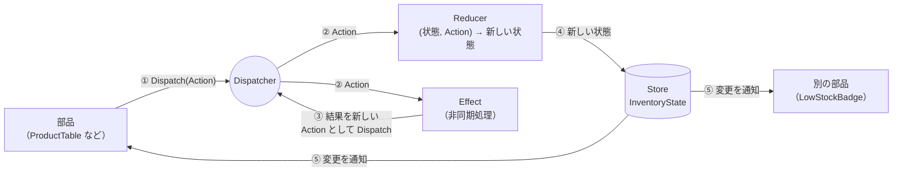

# 第5章 Flux / Redux

[目次へ戻る](../../README.md) ｜ サンプル: [`samples/Part1/05-Flux`](../../samples/Part1/05-Flux/Inventory.Flux)

## 5.1 Flux / Redux とは

Flux は Facebook（現 Meta）が Web アプリのために考えたパターンで、Redux はそれを簡潔にしたライブラリです。
第4章の MVU と同じ **一方向のデータフロー** を、**アプリ全体で共有する状態** に使います。
C# では **Blazor** と、Redux の考え方を取り入れたライブラリ **Fluxor** の組み合わせがよく使われます。

| 役割 | 担当すること |
|---|---|
| **Store** | アプリ全体の状態（State）を1か所で持つ |
| **Action** | 「何が起きたか」を表すデータ（MVU の Msg と同じ） |
| **Reducer** | `(今の状態, Action) → 新しい状態` を計算する関数（MVU の Update と同じ） |
| **Effect** | API 呼び出しなどの非同期処理。結果を新しい Action として送る |
| **Dispatch** | 部品が Action を Store に送ること |

## 5.2 Bad コード：部品ごとに状態を持ち、直接書き換える

Blazor の画面を、一覧・操作パネル・ヘッダーの「要発注 ○件」バッジという3つの部品に分けたとします。
それぞれの部品が、自分で商品データを取得して持つと次のようになります。

```razor
@* ❌ Bad: ProductTable.razor — 自分で商品一覧を持っている *@
@code {
    private List<Product> products = [];
    protected override async Task OnInitializedAsync() => products = await Repository.GetAllAsync();
}
```

```razor
@* ❌ Bad: LowStockBadge.razor — こちらも自分で商品一覧を持っている *@
<span>要発注 @products.Count(p => p.Stock <= p.ReorderPoint) 件</span>
@code {
    private List<Product> products = [];
    protected override async Task OnInitializedAsync() => products = await Repository.GetAllAsync();
}
```

```razor
@* ❌ Bad: StockOperationPanel.razor — 受け取った商品を直接書き換える *@
<button @onclick="Ship">出庫</button>
@code {
    [Parameter] public Product? Selected { get; set; }
    [Parameter] public EventCallback OnChanged { get; set; }

    private async Task Ship()
    {
        if (quantity > Selected!.Stock) { error = "在庫が不足しています"; return; }
        Selected.Stock -= quantity;           // ← 共有しているオブジェクトを直接書き換え
        await OnChanged.InvokeAsync();        // ← 親に「変わったよ」と伝え、親がさらに他の部品へ…
    }
}
```

### 何に困るのか

- **画面の中で表示が食い違う**: 出庫して一覧の在庫数が減っても、`LowStockBadge` は自分のデータを持っているので、「要発注 ○件」が更新されません。
- **変更の通知をバケツリレーする**: 一覧と操作パネルを同期させるために、`[Parameter]` と `EventCallback` を親から子へ、子から親へと何段も受け渡すことになります（prop drilling と呼ばれます）。部品が離れているほど大変です。
- **誰が書き換えたのか分からない**: `Selected.Stock -= quantity` のように共有オブジェクトを直接書き換えると、第4章と同じく、状態がどこで変わったのか追えなくなります。

## 5.3 なぜこの仕組みにしたのか

Flux / Redux は、この問題を次の3つのルールで解決します。

1. **状態はアプリに1つだけ（Store）**: すべての部品は同じ Store を見る。データのコピーを持たない。
2. **状態は読むだけ**: 部品は状態を直接書き換えない。代わりに Action を Dispatch する。
3. **状態を変えるのは Reducer だけ**: Reducer は MVU の Update と同じ純粋関数で、新しい状態を返す。

Store の状態が変わると、それを見ているすべての部品に自動で通知されます。
一覧と「要発注」バッジがどんなに離れていても、同じ Store を見ているので表示が食い違うことはありません。バケツリレーも不要です。

ただし Reducer は純粋関数なので、API 呼び出しのような **待ち時間がある処理や外部へのアクセス（副作用）** は書けません。
そこで、副作用は **Effect** という別の場所に書き、結果を Action として Store に送り返します。

## 5.4 構造



## 5.5 サンプルコードの解説

```
Inventory.Flux/
├── Program.cs                       Fluxor の登録
├── Store/
│   ├── InventoryState.cs            状態
│   ├── InventoryActions.cs          Action の一覧
│   ├── InventoryReducers.cs         Reducer
│   └── InventoryEffects.cs          Effect（商品一覧の読み込み）
└── Components/
    ├── Routes.razor                 Store の初期化
    ├── Layout/MainLayout.razor      ヘッダー（LowStockBadge を置く）
    ├── Pages/Home.razor             ページ
    └── Shared/
        ├── ProductTable.razor       一覧
        ├── StockOperationPanel.razor 入出庫の操作
        └── LowStockBadge.razor      「要発注 ○件」バッジ
```

### State：アプリに1つだけの状態

[`Store/InventoryState.cs`](../../samples/Part1/05-Flux/Inventory.Flux/Store/InventoryState.cs)

```csharp
[FeatureState]
public sealed record InventoryState
{
    public bool IsLoading { get; init; }
    public ImmutableList<Product> Products { get; init; } = [];
    public string? SelectedCode { get; init; }
    public string? Message { get; init; }
    public bool IsError { get; init; }

    public Product? SelectedProduct => Products.FirstOrDefault(p => p.Code == SelectedCode);
}
```

`[FeatureState]` を付けると、Fluxor がこのクラスを Store の状態として登録します。
プロパティは `init`（初期化時にだけ設定できる）なので、作った後は書き換えられません。

### Action：何が起きたか

[`Store/InventoryActions.cs`](../../samples/Part1/05-Flux/Inventory.Flux/Store/InventoryActions.cs)

```csharp
public sealed record LoadProductsAction;
public sealed record LoadProductsSucceededAction(IReadOnlyList<Product> Products);
public sealed record SelectProductAction(string Code);
public sealed record ReceiveStockAction(int Quantity);
public sealed record ShipStockAction(int Quantity);
```

### Reducer：状態が変わるのはここだけ

[`Store/InventoryReducers.cs`](../../samples/Part1/05-Flux/Inventory.Flux/Store/InventoryReducers.cs)

```csharp
[ReducerMethod]
public static InventoryState OnShipStock(InventoryState state, ShipStockAction action)
{
    if (state.SelectedProduct is not { } product)
        return Error(state, "商品を選択してください。");
    if (action.Quantity <= 0)
        return Error(state, "出庫数は1以上で指定してください。");
    if (action.Quantity > product.Stock)
        return Error(state, $"在庫が不足しています（在庫: {product.Stock}、出庫: {action.Quantity}）。");

    return ChangeStock(state, product.Stock - action.Quantity, $"{product.Name} を {action.Quantity} 個出庫しました。");
}
```

`[ReducerMethod]` を付けた static メソッドは、引数の Action の型（ここでは `ShipStockAction`）が Dispatch されたときに Fluxor から呼ばれます。
中身は第4章の `Update` とほぼ同じです。

### Effect：非同期処理を担当する

[`Store/InventoryEffects.cs`](../../samples/Part1/05-Flux/Inventory.Flux/Store/InventoryEffects.cs)

```csharp
public sealed class InventoryEffects(IProductRepository repository)
{
    [EffectMethod]
    public async Task HandleLoadProducts(LoadProductsAction action, IDispatcher dispatcher)
    {
        var products = await repository.GetAllAsync();
        dispatcher.Dispatch(new LoadProductsSucceededAction(products));
    }
}
```

商品一覧の読み込みは、次の2段階で状態に反映されます。

1. `LoadProductsAction` → Reducer が `IsLoading = true` にする ／ 同時に Effect が読み込みを始める
2. 読み込みが終わると、Effect が `LoadProductsSucceededAction` を Dispatch → Reducer が `Products` を設定し `IsLoading = false` にする

Effect は状態を直接書き換えません。**状態を変えるのは、あくまで Reducer だけ** です。

### 部品：状態を読み、Action を Dispatch する

[`Components/Shared/StockOperationPanel.razor`](../../samples/Part1/05-Flux/Inventory.Flux/Components/Shared/StockOperationPanel.razor)

```razor
@inherits FluxorComponent
@inject IState<InventoryState> State
@inject IDispatcher Dispatcher

<button disabled="@(State.Value.SelectedProduct is null)"
        @onclick="() => Dispatcher.Dispatch(new ShipStockAction(quantity))">出庫</button>

@code {
    // 入力途中の値はこの部品だけの一時的な状態なので、Store には入れない
    private int quantity = 1;
}
```

- `FluxorComponent` を継承すると、Store の状態が変わったときに自動で再描画されます。
- Bad コードの `Selected.Stock -= quantity` が、`Dispatch(new ShipStockAction(quantity))` に置き換わりました。部品は「出庫したい」と伝えるだけです。
- 入力途中の数量のように **その部品の中だけで使う値** まで Store に入れる必要はありません。何でも Store に入れると、かえって複雑になります。

[`Components/Shared/LowStockBadge.razor`](../../samples/Part1/05-Flux/Inventory.Flux/Components/Shared/LowStockBadge.razor)

```razor
@inherits FluxorComponent
@inject IState<InventoryState> State

@if (LowStockCount > 0)
{
    <span class="badge">要発注 @LowStockCount 件</span>
}

@code {
    private int LowStockCount => State.Value.Products.Count(p => p.NeedsReorder);
}
```

このバッジはヘッダー（`MainLayout`）にあり、一覧とは親子関係がありません。それでも同じ Store を見ているので、出庫して在庫が発注点を下回ると、件数がすぐに増えます。

### 動かしてみる

```bash
dotnet run --project samples/Part1/05-Flux/Inventory.Flux
```

一覧で P-001 を選び、100 個出庫してみてください。在庫が発注点（50）を下回り、一覧の「要発注」とヘッダーのバッジが同時に更新されます。

> このサンプルは Flux の仕組みを見せることが目的なので、入出庫の結果はブラウザの画面（Store）の中だけに反映され、リポジトリには保存していません。
> 保存も行う場合は、`ShipStockAction` を受け取る Effect を追加して、そこからリポジトリや Web API を呼び出します。

## 5.6 メリット・デメリットと向いている場面

| メリット | デメリット |
|---|---|
| 離れた部品同士でも、表示が食い違わない | 1つの機能を作るのに State・Action・Reducer・Effect とファイルが増える |
| 状態の変化がすべて Action として記録でき、デバッグしやすい（Redux DevTools にも対応） | 小さな画面では明らかに大げさ |
| Reducer は純粋関数なのでテストが簡単 | 「何を Store に入れるか」の判断が必要 |

**向いている場面**: 多くの部品が同じデータを表示・変更する、大きめの Blazor アプリ。

---

[← 前の章：第4章 MVU](04-mvu.md) ｜ [次の章：第1部まとめ →](99-summary.md)
