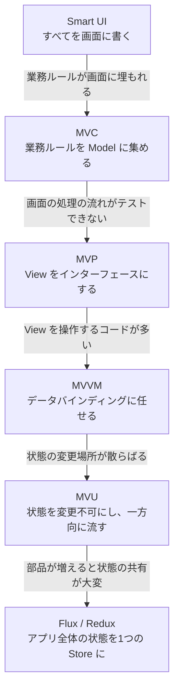

# 第1部まとめ：UI層のパターンの変化

[目次へ戻る](../../README.md)

## パターンは「前のパターンの困りごと」から生まれた

第1部の5つのパターンは、それぞれ前のやり方で困ったことを解決するために生まれました。

## 比較表

| | MVC | MVP | MVVM | MVU | Flux / Redux |
|---|---|---|---|---|---|
| ロジックを持つ役割 | Controller | Presenter | ViewModel | Update | Reducer / Effect |
| ロジック側は View を知っているか | View を選ぶ | インターフェース越しに知っている | 知らない | 知らない | 知らない |
| 画面の更新方法 | リクエストごとに作り直す | Presenter が指示する | バインディングで自動 | 状態から毎回作る | Store の変更通知で自動 |
| 状態の変更 | Model を書き換える | Model を書き換える | プロパティを書き換える | 新しい状態を作る | 新しい状態を作る |
| テストに必要なもの | Controller を呼ぶ準備 | 偽物の View | なし | なし | なし |
| C# での主な使い道 | ASP.NET Core MVC | WinForms | WPF / MAUI / Avalonia | MauiReactor など | Blazor + Fluxor |

## どれを選べばよいか

多くの場合、**使う UI 技術でほぼ決まります**。その技術に合ったパターンを使うのがいちばん楽です。

| 作るもの | おすすめ |
|---|---|
| ページを返す Web アプリ | MVC（ASP.NET Core MVC / Razor Pages） |
| WinForms アプリ | MVP |
| WPF / .NET MAUI / Avalonia / WinUI アプリ | MVVM |
| Blazor アプリ（小〜中規模） | 部品ごとの状態 ＋ 必要ならサービスで共有 |
| Blazor アプリ（部品が多く、状態の共有が複雑） | Flux / Redux（Fluxor） |
| 状態の変化を厳密に管理したい画面 | MVU |

## 共通する大事な考え方

どのパターンにも、次の2つが共通しています。

1. **業務ルールは画面から離す**: 在庫不足のチェックは、どのパターンでも画面のコードには書きませんでした。
2. **ロジックは画面なしでテストできるようにする**: MVP 以降のパターンは、すべて画面を起動せずにテストできました。

ただし、第1部のサンプルでは、業務ルールを持つ Model と、データの保存場所（リポジトリ）の関係については深く考えていませんでした。
**画面より奥の部分をどう分けるか** が、第2部のテーマです。

---

[← 前の章：第5章 Flux / Redux](05-flux.md) ｜ [次の章：第6章 レイヤードアーキテクチャ →](../part2/06-layered.md)
