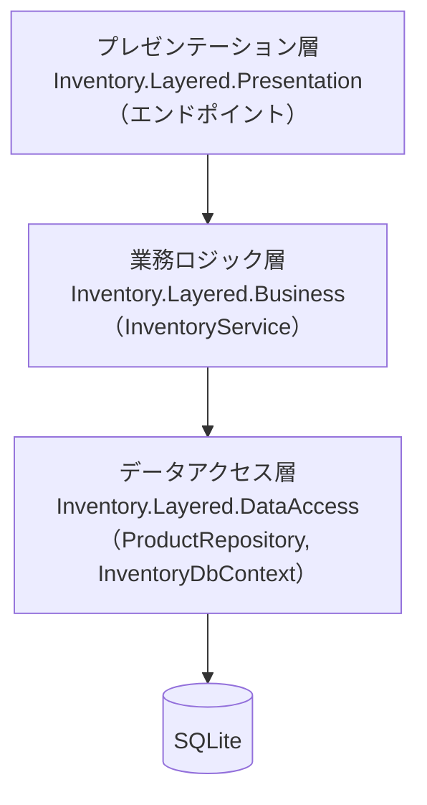
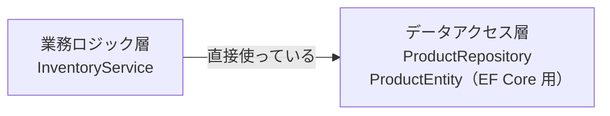

# 第6章 レイヤードアーキテクチャ

[目次へ戻る](../../README.md) ｜ サンプル: [`samples/Part2/06-Layered`](../../samples/Part2/06-Layered)

## 第2部について

第1部では「画面」と「それ以外」の分け方を学びました。第2部では、**画面より奥の部分（業務ルールやデータベース）を含めたアプリ全体** をどう分けるかを学びます。

第2部のサンプルは、すべて **ASP.NET Core の Web API**（Minimal API）です。画面の代わりに HTTP で入出庫を行います。
データベースには SQLite を使い、Entity Framework Core（EF Core）で読み書きします。

## 6.1 レイヤードアーキテクチャとは

アプリを役割ごとの **層（レイヤー）** に分け、**上の層が下の層を使う** という決まりにする、もっとも基本的な構成です。
よく使われるのは次の3層です。

| 層 | 担当すること | このサンプルのプロジェクト |
|---|---|---|
| **プレゼンテーション層** | 画面や HTTP の入出力 | `Inventory.Layered.Presentation` |
| **業務ロジック層**（ビジネス層） | 業務ルール | `Inventory.Layered.Business` |
| **データアクセス層** | データベースの読み書き | `Inventory.Layered.DataAccess` |

## 6.2 Bad コード：1か所に全部書く

Minimal API は手軽なので、エンドポイントの中に何でも書けてしまいます。

```csharp
// ❌ Bad: HTTP・業務ルール・データベース操作がエンドポイントの中に全部ある
app.MapPost("/products/{code}/ship", async (string code, StockRequest request, InventoryDbContext db) =>
{
    if (request.Quantity <= 0)
        return Results.BadRequest(new { error = "出庫数は1以上で指定してください。" });

    var product = await db.Products.FindAsync(code);
    if (product is null)
        return Results.NotFound();

    if (request.Quantity > product.Stock)
        return Results.BadRequest(new { error = "在庫が不足しています。" });

    product.Stock -= request.Quantity;
    await db.SaveChangesAsync();
    return Results.Ok(product);    // ← データベースのクラスをそのまま返している
});

// 入庫のエンドポイント、在庫一覧のエンドポイント、CSV 取り込みのバッチ…
// それぞれに同じようなチェックとデータベース操作が並ぶ
```

### 何に困るのか

- **同じ業務ルールが何か所にも書かれる**: 「在庫不足なら出庫できない」を、出庫 API にも、CSV からの一括出庫バッチにも書くことになります。
- **データベースの構造がそのまま外に出る**: `product`（データベースのクラス）をそのまま返しているので、テーブルに列を追加すると API の応答まで変わってしまいます。
- **どこに何が書いてあるか分からない**: アプリが大きくなると、「在庫のルールはどこ？」「SQL はどこ？」を探すのに、全部のファイルを読むことになります。

## 6.3 なぜこの仕組みにしたのか

レイヤードアーキテクチャは、**処理を性質ごとに層に分け、置き場所を決める** ことでこれを解決します。

- 業務ルールは業務ロジック層に1つだけ書く → API からもバッチからも同じルールを使える
- データベースの読み書きはデータアクセス層にまとめる → SQL やテーブルの都合が上の層に広がらない
- プレゼンテーション層は HTTP の入出力だけを担当する

そして、**依存の向きを上から下の一方向にする** のが大事な決まりです。

- プレゼンテーション層は業務ロジック層を使ってよい
- 業務ロジック層はデータアクセス層を使ってよい
- **下の層が上の層を使ってはいけない**（データアクセス層が HTTP のことを知っている、などはダメ）

一方向にすることで、上の層（画面）を作り直しても、下の層（業務ルールやデータベース操作）には影響しません。

## 6.4 構造



C# では、層ごとに **プロジェクト** を分け、プロジェクト参照（`<ProjectReference>`）で依存の向きを表します。
こうすると、たとえばデータアクセス層から業務ロジック層のクラスを使おうとしても、参照がないのでコンパイルエラーになります。決まりをコンパイラに守らせることができるのです。

## 6.5 サンプルコードの解説

### データアクセス層：データベースの読み書きだけ

[`DataAccess/ProductEntity.cs`](../../samples/Part2/06-Layered/Inventory.Layered.DataAccess/ProductEntity.cs)・[`DataAccess/ProductRepository.cs`](../../samples/Part2/06-Layered/Inventory.Layered.DataAccess/ProductRepository.cs)

```csharp
public class ProductEntity      // Products テーブルに対応するクラス
{
    public string Code { get; set; } = "";
    public string Name { get; set; } = "";
    public int Stock { get; set; }
    public int ReorderPoint { get; set; }
}

public class ProductRepository(InventoryDbContext db)
{
    public async Task<IReadOnlyList<ProductEntity>> GetAllAsync() =>
        await db.Products.OrderBy(p => p.Code).ToListAsync();

    public async Task<ProductEntity?> FindByCodeAsync(string code) =>
        await db.Products.FindAsync(code);

    public Task SaveChangesAsync() => db.SaveChangesAsync();
}
```

業務ルールは一切ありません。「取ってくる」「保存する」だけです。

### 業務ロジック層：業務ルールを1か所に

[`Business/InventoryService.cs`](../../samples/Part2/06-Layered/Inventory.Layered.Business/InventoryService.cs)

```csharp
public class InventoryService(ProductRepository repository)
{
    public async Task<ProductDto> ShipAsync(string code, int quantity)
    {
        if (quantity <= 0)
            throw new BusinessException("出庫数は1以上で指定してください。");

        var product = await repository.FindByCodeAsync(code) ?? throw new ProductNotFoundException(code);
        if (quantity > product.Stock)
            throw new BusinessException($"在庫が不足しています（在庫: {product.Stock}、出庫: {quantity}）。");

        product.Stock -= quantity;
        await repository.SaveChangesAsync();
        return ProductDto.From(product);
    }
}
```

- 業務ルールの違反は `BusinessException` で知らせます。業務ロジック層は「HTTP の 400 エラー」のことを知りません。
- 戻り値は `ProductEntity` ではなく [`ProductDto`](../../samples/Part2/06-Layered/Inventory.Layered.Business/ProductDto.cs) です。データベースのクラスを上の層に渡さないことで、テーブル構造の変更が API の応答に直接響かないようにしています。

### プレゼンテーション層：HTTP の入出力だけ

[`Presentation/Program.cs`](../../samples/Part2/06-Layered/Inventory.Layered.Presentation/Program.cs)

```csharp
builder.Services.AddDataAccessLayer("Data Source=inventory-layered.db");
builder.Services.AddBusinessLayer();
builder.Services.AddExceptionHandler<BusinessExceptionHandler>();
...
app.MapPost("/products/{code}/ship", (string code, StockRequest request, InventoryService service) =>
    service.ShipAsync(code, request.Quantity));
```

エンドポイントは、受け取った値を業務ロジック層に渡して、結果を返すだけになりました。
業務ロジック層の例外を HTTP のエラー（404 / 400）に変換するのは、[`BusinessExceptionHandler`](../../samples/Part2/06-Layered/Inventory.Layered.Presentation/BusinessExceptionHandler.cs) の仕事です。HTTP の知識は、プレゼンテーション層の中だけに閉じています。

### 動かしてみる

```bash
dotnet run --project samples/Part2/06-Layered/Inventory.Layered.Presentation
```

[`Inventory.Layered.Presentation.http`](../../samples/Part2/06-Layered/Inventory.Layered.Presentation/Inventory.Layered.Presentation.http) を開いてリクエストを送ってみてください。

## 6.6 残っている問題（第7章へ）

レイヤードで置き場所は整理できましたが、依存の向きをもう一度見てください。



**いちばん大事な業務ルールが、データベースの都合に依存しています。**

- `InventoryService` のテストを書こうとすると、`ProductRepository`（具体的なクラス）が必要で、その先には本物の `InventoryDbContext` とデータベースが必要です。
- データベースを SQLite から別のもの（たとえば Web API 経由の外部システム）に変えると、データアクセス層だけでなく業務ロジック層まで書き直しになります。
- 業務ロジック層が使っている `ProductEntity` は、データベースのテーブルに合わせたクラスです。テーブルの都合で業務ロジックが変わってしまいます。

また、業務ルールが `InventoryService` に書かれ、`ProductEntity` はデータを持つだけになっています。この問題は第8章で扱います。

## 6.7 メリット・デメリットと向いている場面

| メリット | デメリット |
|---|---|
| 構成が分かりやすく、多くの人が知っている | 業務ロジック層がデータアクセス層に依存するので、データベースなしでテストしにくい |
| 処理の置き場所が決まり、探しやすい | 機能を1つ足すたびに全層のファイルを触ることになる |
| プロジェクト参照で依存の向きをコンパイラに守らせられる | 「ただ値を受け渡すだけ」の層が生まれやすい |

**向いている場面**: 業務ルールが少なく、データベースの読み書きが中心のアプリ。チームの全員がすぐ理解できる構成にしたいとき。

---

[← 前の章：第1部まとめ](../part1/99-summary.md) ｜ [次の章：第7章 クリーンアーキテクチャ →](07-clean-architecture.md)
