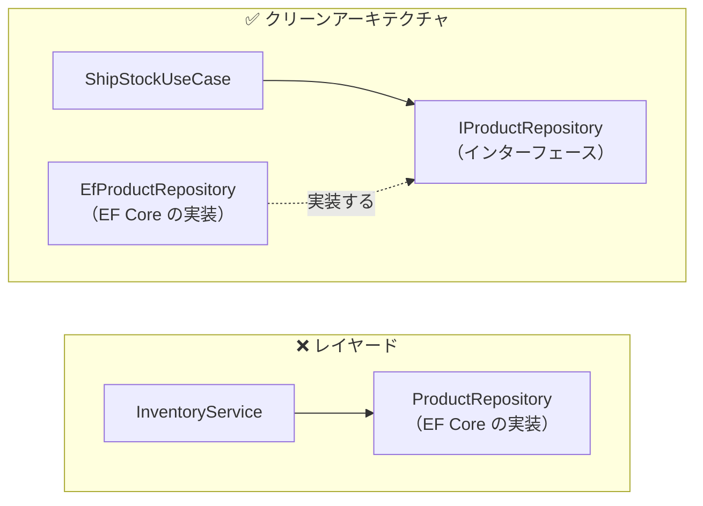
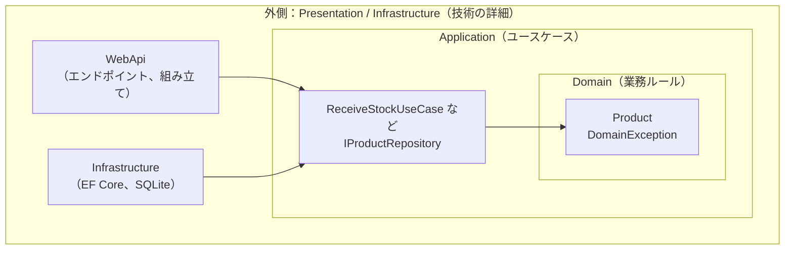
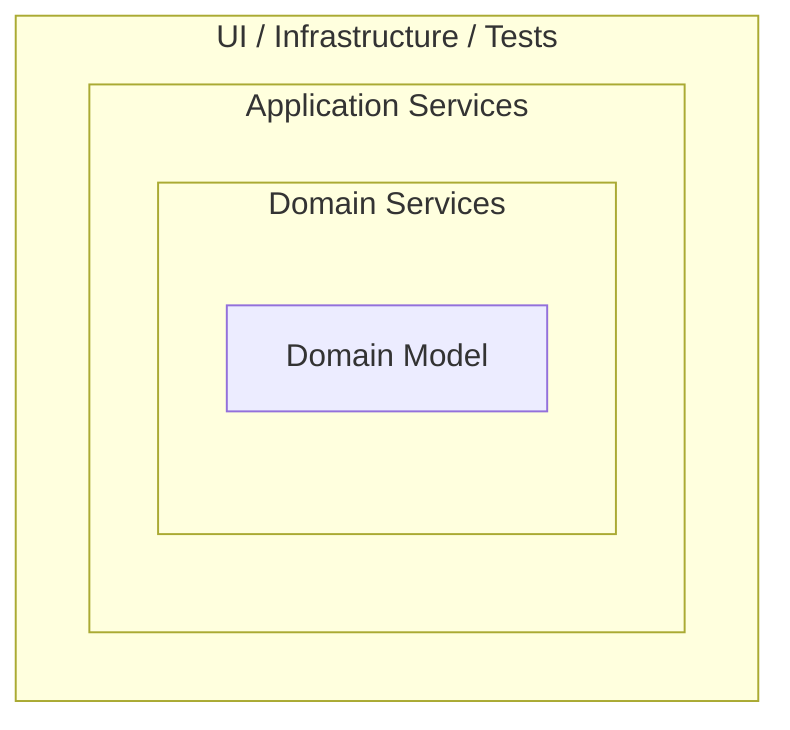
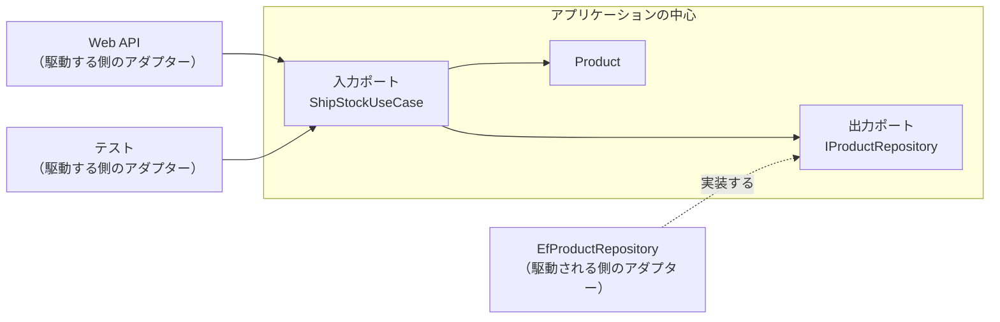

# 第7章 クリーンアーキテクチャ

[目次へ戻る](../../README.md) ｜ サンプル: [`samples/Part2/07-CleanArchitecture`](../../samples/Part2/07-CleanArchitecture)

## 7.1 クリーンアーキテクチャとは

クリーンアーキテクチャは、Robert C. Martin（通称 Uncle Bob）が 2012 年に提唱した構成です。
いちばん大事なルールは次の1つだけです。

> **依存は、必ず外側から内側に向ける。内側は外側のことを何も知らない。**

ここでいう「内側」は業務ルール、「外側」はデータベース・Web・UI などの技術的な詳細です。
.NET では特に人気があり、多くのテンプレートやサンプルがこの構成を使っています。

## 7.2 Bad コード：業務ルールがデータベースに依存している

第6章の最後で見た問題を、もう少しはっきりさせます。業務ロジック層が、データアクセス層の具体的なクラスを使っています。

```csharp
// ❌ Bad: 業務ロジックが EF Core の具体的なクラスに直接依存している
using Inventory.Layered.DataAccess;   // ← データアクセス層を参照

public class InventoryService(ProductRepository repository)   // ← 具体的なクラス
{
    public async Task<ProductDto> ShipAsync(string code, int quantity)
    {
        var product = await repository.FindByCodeAsync(code);  // ← 戻り値は EF Core 用の ProductEntity
        ...
    }
}
```

このクラスのテストを書こうとすると、次のようになります。

```csharp
// ❌ Bad: 業務ルールを1つ確かめるだけなのに、データベースの準備が必要
[Fact]
public async Task 在庫不足なら出庫できない()
{
    var options = new DbContextOptionsBuilder<InventoryDbContext>()
        .UseSqlite("Data Source=test.db").Options;
    await using var db = new InventoryDbContext(options);
    await db.Database.EnsureCreatedAsync();
    db.Products.Add(new ProductEntity { Code = "P-001", Stock = 2, ... });
    await db.SaveChangesAsync();

    var service = new InventoryService(new ProductRepository(db));
    await Assert.ThrowsAsync<BusinessException>(() => service.ShipAsync("P-001", 3));
}
```

### 何に困るのか

- **テストが重く、壊れやすい**: 業務ルールを確かめたいだけなのに、データベースファイルの作成・初期データの投入・後片付けが必要です。テストが遅くなり、前のテストのデータが残って失敗する、といった問題も起きます。
- **技術の変更が業務ルールに波及する**: EF Core から別のデータアクセス方法に変える、データの取得元を外部の Web API に変える、といった変更のたびに、業務ロジック層まで書き直しになります。
- **大事なものが、変わりやすいものに依存している**: 業務ルール（在庫不足なら出庫できない）は、技術の流行とは関係なく何年も変わりません。一方、データベースやライブラリはよく変わります。**変わりにくい大事なものが、変わりやすいものに引きずられている** のが根本的な問題です。

## 7.3 なぜこの仕組みにしたのか：依存性の逆転

解決の鍵は **依存性逆転の原則（Dependency Inversion Principle）** です。

レイヤードでは、業務ロジックが「データアクセスの実装」を直接使っていました。
クリーンアーキテクチャでは、**業務ロジックの側が「こういうものが欲しい」というインターフェースを決め**、データアクセスの側がそれを実装します。



- インターフェース `IProductRepository` は **内側（Application 層）** に置きます。
- EF Core を使った実装 `EfProductRepository` は **外側（Infrastructure 層）** に置きます。
- 矢印を見ると、外側の Infrastructure が内側の Application に向かっています。**依存の向きが逆転** しました。

これで業務ロジックは、データベースが SQLite なのか、メモリ上の偽物なのかを知らずに済みます。テストでは、`IProductRepository` を実装した簡単な偽物を渡すだけです。

## 7.4 構造

クリーンアーキテクチャは、よく同心円で描かれます。



| 層 | プロジェクト | 中身 | 参照してよいもの |
|---|---|---|---|
| **Domain** | `Inventory.Clean.Domain` | エンティティと業務ルール | なし |
| **Application** | `Inventory.Clean.Application` | ユースケース、外部に求めるインターフェース | Domain |
| **Infrastructure** | `Inventory.Clean.Infrastructure` | EF Core によるインターフェースの実装 | Application（と Domain） |
| **Presentation** | `Inventory.Clean.WebApi` | エンドポイント、全体の組み立て | Application、Infrastructure |

Domain と Application のプロジェクトは、**EF Core も ASP.NET Core も参照していません**。`.csproj` を開いて確かめてみてください。

## 7.5 サンプルコードの解説

### Domain：業務ルールを持つエンティティ

[`Domain/Product.cs`](../../samples/Part2/07-CleanArchitecture/Inventory.Clean.Domain/Product.cs)

```csharp
public class Product
{
    public string Code { get; private set; }
    public int Stock { get; private set; }
    ...
    public void Ship(int quantity)
    {
        if (quantity <= 0)
            throw new DomainException("出庫数は1以上で指定してください。");
        if (quantity > Stock)
            throw new DomainException($"在庫が不足しています（在庫: {Stock}、出庫: {quantity}）。");
        Stock -= quantity;
    }
}
```

第6章では業務ルールが `InventoryService` にあり、`ProductEntity` はデータを入れておくだけの箱でした。
ここでは、ルールをエンティティ自身に持たせています。EF Core の属性などは一切付いていない、ただの C# クラスです。

### Application：ユースケースとインターフェース

[`Application/Abstractions/IProductRepository.cs`](../../samples/Part2/07-CleanArchitecture/Inventory.Clean.Application/Abstractions/IProductRepository.cs)

```csharp
public interface IProductRepository
{
    Task<IReadOnlyList<Product>> GetAllAsync(CancellationToken cancellationToken = default);
    Task<Product?> FindByCodeAsync(string code, CancellationToken cancellationToken = default);
    Task SaveChangesAsync(CancellationToken cancellationToken = default);
}
```

[`Application/Products/ShipStockUseCase.cs`](../../samples/Part2/07-CleanArchitecture/Inventory.Clean.Application/Products/ShipStockUseCase.cs)

```csharp
public class ShipStockUseCase(IProductRepository repository)
{
    public async Task<ProductDto> ExecuteAsync(string code, int quantity, CancellationToken cancellationToken = default)
    {
        var product = await repository.FindByCodeAsync(code, cancellationToken)
            ?? throw new ProductNotFoundException(code);

        product.Ship(quantity);                              // ルールはエンティティに任せる
        await repository.SaveChangesAsync(cancellationToken);
        return ProductDto.From(product);
    }
}
```

**ユースケース** は「アプリで何ができるか」を1つずつクラスにしたものです。
ユースケースは「取り出す → エンティティに頼む → 保存する」という **手順** だけを書き、ルールそのものは Domain に任せます。
ファイル一覧を見るだけで、このアプリにできること（一覧・入庫・出庫）が分かるのも利点です。

### Infrastructure：インターフェースを技術で実装する

[`Infrastructure/Persistence/EfProductRepository.cs`](../../samples/Part2/07-CleanArchitecture/Inventory.Clean.Infrastructure/Persistence/EfProductRepository.cs)

```csharp
public class EfProductRepository(InventoryDbContext db) : IProductRepository
{
    public async Task<Product?> FindByCodeAsync(string code, CancellationToken cancellationToken = default) =>
        await db.Products.FindAsync(new object[] { code }, cancellationToken);
    ...
}
```

[`Infrastructure/Persistence/InventoryDbContext.cs`](../../samples/Part2/07-CleanArchitecture/Inventory.Clean.Infrastructure/Persistence/InventoryDbContext.cs) では、テーブル名や主キーの設定を `OnModelCreating` に書いています。
データベースの都合は、すべて外側の Infrastructure に閉じ込めています。

### Presentation：組み立てとエンドポイント

[`WebApi/Program.cs`](../../samples/Part2/07-CleanArchitecture/Inventory.Clean.WebApi/Program.cs)

```csharp
// ===== 組み立て: どのインターフェースにどの実装を使うかを決めるのはここだけ =====
builder.Services.AddInfrastructure("Data Source=inventory-clean.db");
builder.Services.AddScoped<ShipStockUseCase>();
...
app.MapPost("/products/{code}/ship", (string code, StockRequest request, ShipStockUseCase useCase, CancellationToken ct) =>
    useCase.ExecuteAsync(code, request.Quantity, ct));
```

`AddInfrastructure` の中で `services.AddScoped<IProductRepository, EfProductRepository>()` と登録しています。
「`IProductRepository` が必要なら `EfProductRepository` を渡す」という **対応づけを決めるのは、アプリの入り口であるこの場所だけ** です。この場所を **Composition Root**（組み立ての根元）と呼びます。

### テスト：データベースなしで業務ルールを確かめる

[`Part2.Tests/CleanUseCaseTests.cs`](../../samples/Part2/Part2.Tests/CleanUseCaseTests.cs)

```csharp
private sealed class InMemoryProductRepository(params Product[] products) : IProductRepository
{
    public int SaveCount { get; private set; }
    public Task<Product?> FindByCodeAsync(string code, CancellationToken cancellationToken = default) =>
        Task.FromResult(products.FirstOrDefault(p => p.Code == code));
    public Task SaveChangesAsync(CancellationToken cancellationToken = default) { SaveCount++; return Task.CompletedTask; }
    ...
}

[Fact]
public async Task 在庫不足で出庫すると例外になり保存されない()
{
    var repository = new InMemoryProductRepository(new Product("P-001", "ボールペン", 2, 5));
    var useCase = new ShipStockUseCase(repository);

    await Assert.ThrowsAsync<DomainException>(() => useCase.ExecuteAsync("P-001", 3));
    Assert.Equal(0, repository.SaveCount);
}
```

7.2 の Bad コードのテストと比べてください。データベースの準備がなくなり、確かめたいことだけが書かれています。
テストプロジェクトは Infrastructure を参照していないので、EF Core がなくてもテストできます。

```bash
dotnet test samples/Part2/Part2.Tests --filter "FullyQualifiedName~CleanUseCaseTests"
dotnet run --project samples/Part2/07-CleanArchitecture/Inventory.Clean.WebApi
```

---

## コラム：オニオンアーキテクチャとヘキサゴナルアーキテクチャ

クリーンアーキテクチャとよく似た構成が、ほかにも2つあります。実はクリーンアーキテクチャは、これらの考え方をまとめたものです。

### オニオンアーキテクチャ（2008年、Jeffrey Palermo）

玉ねぎのように、アプリを同心円の層で表します。



- 中心に **Domain Model**、その外側に **Domain Services**、さらに外側に **Application Services**、いちばん外側に UI・データベース・テストがあります。
- ルールはクリーンアーキテクチャと同じで、「依存は外側から内側へ」です。
- **.NET の世界で特に広まった** 構成で、プロジェクトの分け方は本章のサンプルとほぼ同じになります。

### ヘキサゴナルアーキテクチャ（2005年、Alistair Cockburn）

正式名は **Ports and Adapters**（ポートとアダプター）です。六角形は「辺がたくさんある＝外部との接続口がたくさんある」ことを表しているだけで、6という数に意味はありません。



- **ポート**: アプリの中心が外部とやり取りするための口。本章のサンプルでは、ユースケース（入力ポート）と `IProductRepository`（出力ポート）がこれにあたります。
- **アダプター**: ポートと外部の技術をつなぐもの。Web API のエンドポイントや `EfProductRepository` がこれにあたります。
- 層の内側・外側ではなく、**「中心」と「外部」の2つ** に分けて考えるのが特徴です。Web API から呼ばれても、テストから呼ばれても、中心は同じように動きます。

### 3つの比較

| | ヘキサゴナル | オニオン | クリーン |
|---|---|---|---|
| 発表 | 2005年 | 2008年 | 2012年 |
| 図の形 | 六角形（中心と外部） | 同心円 | 同心円 |
| 中心にあるもの | アプリケーション | Domain Model | Entities |
| 強調していること | 外部との接続口（ポート）を抽象化する | ドメインを中心に層を重ねる | 依存のルールを明確にする |
| 共通点 | **業務ルールを中心に置き、技術の詳細は外側から依存させる** |||

名前と図は違いますが、目指しているものは同じです。チームで話すときは「どの名前か」より、**依存が内側を向いているか** を確かめることが大切です。

---

## 7.6 メリット・デメリットと向いている場面

| メリット | デメリット |
|---|---|
| 業務ルールを、データベースや Web なしでテストできる | プロジェクト・インターフェース・DTO が増え、小さなアプリでは大げさ |
| データベースや UI の技術を変えても、内側は変わらない | 「どの層に置くか」で迷う場面が増える |
| 依存のルールがはっきりしていて、チームで守りやすい | 層をまたぐたびに DTO への詰め替えが必要になる |

**向いている場面**: 業務ルールが多く、長く保守するアプリ。将来、データベースや外部システムが変わる可能性があるアプリ。

> **注意**: クリーンアーキテクチャは「同心円の層の名前」や「プロジェクトの数」を決めたものではありません。
> 4つのプロジェクトに分けることより、**内側が外側を知らない** というルールを守ることが本質です。小さなアプリなら、1つのプロジェクトの中でフォルダを分けるだけでも構いません。

---

[← 前の章：第6章 レイヤードアーキテクチャ](06-layered.md) ｜ [次の章：第8章 DDD →](08-ddd.md)
