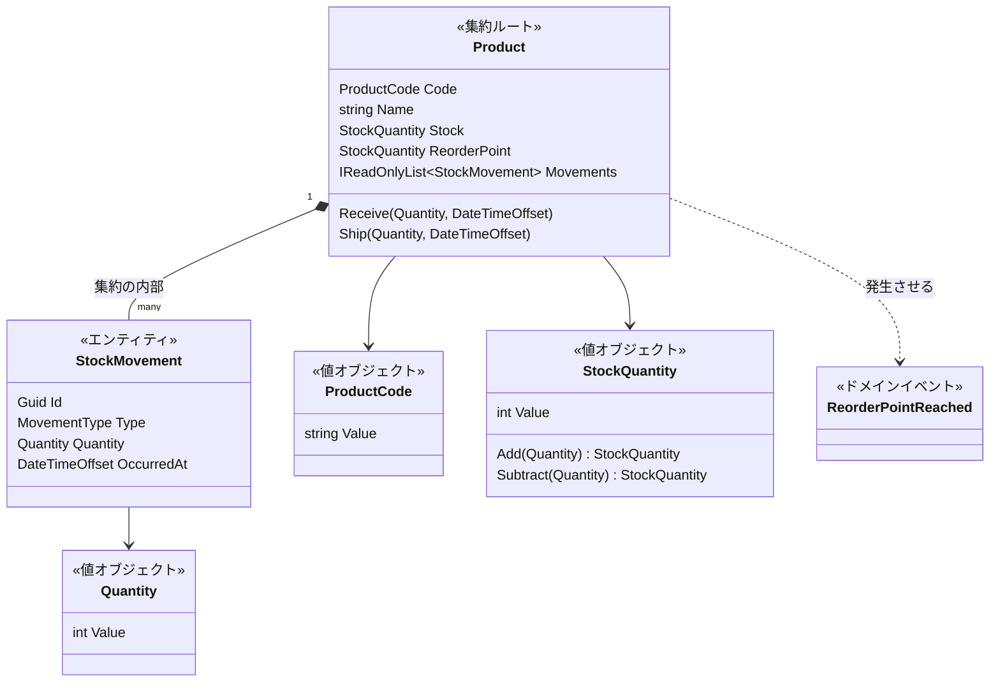

# 第8章 DDD（ドメイン駆動設計）

[目次へ戻る](../../README.md) ｜ サンプル: [`samples/Part2/08-Ddd`](../../samples/Part2/08-Ddd/Inventory.Ddd.Domain)

## 8.1 DDD とは

DDD（Domain-Driven Design）は、Eric Evans が 2003 年の著書で提唱した **設計の進め方** です。
厳密にはアーキテクチャパターンではなく、「業務（ドメイン）の知識を、そのままコードの形にしよう」という考え方の集まりです。

DDD には大きく2つの側面があります。

| 側面 | 内容 | 例 |
|---|---|---|
| **戦略的設計** | 業務をどう理解し、どこで区切るか | ユビキタス言語（業務の人と開発者が同じ言葉を使う）、境界づけられたコンテキスト（「商品」の意味が在庫管理と販売で違うなら、別々に設計する） |
| **戦術的設計** | 業務の知識をどんな部品でコードにするか | 値オブジェクト、エンティティ、集約、リポジトリ、ドメインイベント |

この章では、コードに直接関わる **戦術的設計** を、第7章のクリーンアーキテクチャの **Domain 層** に組み込む形で学びます。
Application・Infrastructure・WebApi の構成は第7章と同じなので、サンプルは Domain 層とそのテストだけにしています。

## 8.2 Bad コード：ドメインモデル貧血症

第6章のレイヤードでは、業務ルールがサービスにあり、エンティティはデータを入れる箱でした。

```csharp
// ❌ Bad: データを持つだけで、振る舞い（ルール）を持たないエンティティ
public class Product
{
    public string Code { get; set; } = "";
    public int Stock { get; set; }            // 誰でも好きな値を入れられる
    public int ReorderPoint { get; set; }
    public List<StockMovement> Movements { get; set; } = [];  // 誰でも履歴を追加・削除できる
}

public class StockMovement
{
    public string Type { get; set; } = "";    // "入庫" "出庫"… "入荷" と書いたら？
    public int Quantity { get; set; }
}

// ルールはサービスにある
public class InventoryService
{
    public void Ship(string code, int quantity)
    {
        var product = _repository.Find(code);
        if (quantity <= 0) throw new Exception("数量は1以上");
        if (quantity > product.Stock) throw new Exception("在庫不足");
        product.Stock -= quantity;
        product.Movements.Add(new StockMovement { Type = "出庫", Quantity = quantity });
    }
}

// 別の開発者が、棚卸し画面のために書いたコード
public class StocktakingService
{
    public void Adjust(string code, int actualStock)
    {
        var product = _repository.Find(code);
        product.Stock = actualStock;  // ← 履歴を残し忘れている。マイナス値のチェックもない
    }
}
```

このように、データだけを持ち、振る舞いを持たないエンティティを **ドメインモデル貧血症（Anemic Domain Model）** と呼びます。

さらに、値をすべて `string` や `int` で表していることも問題です（**基本データ型への執着**、Primitive Obsession）。

```csharp
// ❌ Bad: 引数の順番を間違えても、どちらも int なのでコンパイルが通る
public void Ship(int quantity, int reorderPoint) { ... }
service.Ship(product.ReorderPoint, 10);   // 逆に渡しているが気づけない

// ❌ Bad: 商品コードの形式チェックが、使う場所ごとにバラバラ
if (!Regex.IsMatch(code, @"^P-\d{3}$")) ...   // 画面
if (code.StartsWith("P-")) ...                 // バッチ（チェックが甘い）
```

### 何に困るのか

- **ルールを迂回できてしまう**: `Stock` の setter が公開されているので、`StocktakingService` のように「履歴を残さずに在庫を変える」コードが書けてしまいます。在庫数と履歴の合計が合わなくなります。
- **ルールが散らばる**: 「数量は1以上」「在庫はマイナスにならない」といったルールが、サービスごとにコピーされます。
- **不正な値が作れる**: `quantity = -5` や、形式の違う商品コードが、チェックされないまま奥まで入ってきます。

## 8.3 なぜこの仕組みにしたのか

DDD の戦術的設計は、**ルールをデータのすぐそばに置き、ルールを迂回する手段をなくす** ための部品をそろえています。

| 部品 | 一言でいうと | 解決すること |
|---|---|---|
| **値オブジェクト** | 値そのものを表す型。不変で、値が同じなら等しい | 不正な値を作れなくする。チェックを1か所にまとめる |
| **エンティティ** | ID で区別されるもの。状態が変わっても同じもの | 「同じ商品かどうか」を ID で判断する |
| **集約** | 一緒に変更しなければならないもののまとまり。入口は **集約ルート** の1つだけ | ルールを迂回する手段をなくす |
| **リポジトリ** | 集約を丸ごと保存・復元する | 集約の一部だけを勝手に保存させない |
| **ドメインイベント** | 業務上の重要な出来事 | 「発注点を下回った」などを、他の処理に知らせる |

## 8.4 構造



**Product 集約** は、商品と入出庫履歴をひとまとまりとして扱います。外から履歴に直接触る方法はなく、必ず `Product.Receive()` / `Product.Ship()` を通ります。

## 8.5 サンプルコードの解説

```
Inventory.Ddd.Domain/
├── SeedWork/
│   ├── AggregateRoot.cs       集約ルートの基底クラス、IDomainEvent
│   └── DomainException.cs
└── Products/
    ├── ProductCode.cs         値オブジェクト
    ├── Quantity.cs            値オブジェクト
    ├── StockQuantity.cs       値オブジェクト
    ├── StockMovement.cs       エンティティ（集約の内部）
    ├── Product.cs             集約ルート ＋ ドメインイベント
    └── IProductRepository.cs  リポジトリのインターフェース
```

### 値オブジェクト：不正な値を作れなくする

[`Products/ProductCode.cs`](../../samples/Part2/08-Ddd/Inventory.Ddd.Domain/Products/ProductCode.cs)

```csharp
public sealed partial record ProductCode
{
    public ProductCode(string value)
    {
        if (string.IsNullOrWhiteSpace(value) || !Pattern().IsMatch(value))
            throw new DomainException($"商品コードの形式が正しくありません: '{value}'（例: P-001）");
        Value = value;
    }

    public string Value { get; }

    [GeneratedRegex(@"^P-\d{3}$")]
    private static partial Regex Pattern();
}
```

- 形式のチェックはコンストラクターの1か所だけです。**`ProductCode` 型の値があれば、それは必ず正しい形式** なので、使う側で毎回チェックする必要がありません。
- `record` にしているので、`Value` が同じなら `==` で等しくなります（値オブジェクトの「値が同じなら等しい」という性質）。

[`Products/Quantity.cs`](../../samples/Part2/08-Ddd/Inventory.Ddd.Domain/Products/Quantity.cs)・[`Products/StockQuantity.cs`](../../samples/Part2/08-Ddd/Inventory.Ddd.Domain/Products/StockQuantity.cs)

```csharp
public sealed record Quantity        // 入出庫の数量: 1以上
{
    public Quantity(int value)
    {
        if (value <= 0) throw new DomainException("数量は1以上で指定してください。");
        Value = value;
    }
    public int Value { get; }
}

public sealed record StockQuantity   // 在庫数: 0以上
{
    public StockQuantity Subtract(Quantity quantity)
    {
        if (quantity.Value > Value)
            throw new DomainException($"在庫が不足しています（在庫: {Value}、出庫: {quantity.Value}）。");
        return new(Value - quantity.Value);   // 自分は変えずに、新しい値を返す
    }
}
```

「数量」と「在庫数」を別の型にしたことで、次のような間違いがコンパイルエラーになります。

```csharp
product.Ship(product.ReorderPoint, now);  // コンパイルエラー: StockQuantity は Quantity ではない
```

「在庫は足りるか」というルールが `StockQuantity.Subtract()` の中にあるので、在庫をマイナスにする方法がそもそも存在しません。

### 集約ルート：ルールを迂回させない

[`Products/Product.cs`](../../samples/Part2/08-Ddd/Inventory.Ddd.Domain/Products/Product.cs)

```csharp
public sealed class Product : AggregateRoot
{
    private readonly List<StockMovement> _movements = [];

    public StockQuantity Stock { get; private set; }
    public IReadOnlyList<StockMovement> Movements => _movements.AsReadOnly();

    public void Ship(Quantity quantity, DateTimeOffset occurredAt)
    {
        var wasAboveReorderPoint = !NeedsReorder;

        Stock = Stock.Subtract(quantity);
        _movements.Add(new StockMovement(MovementType.Shipment, quantity, occurredAt));

        if (wasAboveReorderPoint && NeedsReorder)
            AddDomainEvent(new ReorderPointReached(Code, Stock, occurredAt));
    }
}
```

8.2 の Bad コードの問題が、それぞれ次のように解決されています。

| Bad コードの問題 | この集約での対策 |
|---|---|
| `Stock` を誰でも書き換えられる | setter が `private`。変えるには `Receive` / `Ship` を通るしかない |
| 履歴を残し忘れる | 在庫の変更と履歴の追加が、同じメソッドの中で必ずセットで行われる |
| 履歴を外から追加・削除できる | 公開しているのは読み取り専用の `IReadOnlyList`。`StockMovement` のコンストラクターも `internal` |
| `Type = "入荷"` のような打ち間違い | `MovementType` は列挙型 |

`occurredAt`（いつ起きたか）を引数で受け取っているのは、テストで時刻を固定できるようにするためです。メソッドの中で `DateTimeOffset.Now` を呼ぶと、テストのたびに結果が変わってしまいます。

### エンティティ：ID で区別する

[`Products/StockMovement.cs`](../../samples/Part2/08-Ddd/Inventory.Ddd.Domain/Products/StockMovement.cs)

入出庫履歴は、同じ時刻に同じ数量の出庫が2回あっても、別々の履歴として扱う必要があります。そのため値オブジェクトではなく、`Id` を持つエンティティにしています。

| | 値オブジェクト | エンティティ |
|---|---|---|
| 等しいかどうか | 値がすべて同じなら等しい | ID が同じなら等しい |
| 変更 | 不変（変えるときは新しく作る） | 状態が変わっても同じもの |
| 例 | 商品コード、数量、金額 | 商品、入出庫履歴、注文 |

### ドメインイベント：重要な出来事を知らせる

```csharp
public sealed record ReorderPointReached(ProductCode Code, StockQuantity Stock, DateTimeOffset OccurredAt) : IDomainEvent;
```

「在庫が発注点に達したら、購買担当にメールを送る」という要件があったとします。
メール送信を `Product` の中に書くと、Domain がメールの技術に依存してしまいます。
そこで、`Product` は「発注点に達した」という **出来事を記録するだけ** にします。Application 層が保存のタイミングで `DomainEvents` を取り出し、メール送信などの処理に渡します。

### リポジトリ：集約単位で保存する

[`Products/IProductRepository.cs`](../../samples/Part2/08-Ddd/Inventory.Ddd.Domain/Products/IProductRepository.cs)

```csharp
public interface IProductRepository
{
    Task<Product?> FindAsync(ProductCode code, CancellationToken cancellationToken = default);
    Task AddAsync(Product product, CancellationToken cancellationToken = default);
    Task SaveChangesAsync(CancellationToken cancellationToken = default);
}
```

`StockMovement` 用のリポジトリはありません。履歴だけを取り出して保存できると、集約で守ったルールを迂回できてしまうからです。**リポジトリは集約ルートごとに1つ** が原則です。

### テスト

[`Part2.Tests/DddDomainTests.cs`](../../samples/Part2/Part2.Tests/DddDomainTests.cs)

```csharp
[Fact]
public void 発注点を下回った瞬間だけイベントが発生する()
{
    var product = CreateProduct(stock: 15, reorderPoint: 10);

    product.Ship(new Quantity(3), Now);  // 15 → 12: まだ発注点より上
    Assert.Empty(product.DomainEvents);

    product.Ship(new Quantity(2), Now);  // 12 → 10: 発注点に到達
    var domainEvent = Assert.IsType<ReorderPointReached>(Assert.Single(product.DomainEvents));

    product.Ship(new Quantity(1), Now);  // 10 → 9: すでに下回っているので新しいイベントは出ない
    Assert.Single(product.DomainEvents);
}
```

Domain 層は何にも依存していないので、テストは `new` して呼ぶだけです。

```bash
dotnet test samples/Part2/Part2.Tests --filter "FullyQualifiedName~DddDomainTests"
```

### 参考：EF Core で値オブジェクトを保存するには

このサンプルには Infrastructure 層を含めていませんが、第7章の構成に組み込む場合は、`InventoryDbContext.OnModelCreating` で次のように対応づけます。Domain のクラスには手を入れません。

```csharp
modelBuilder.Entity<Product>(product =>
{
    product.HasKey(p => p.Code);
    // 値オブジェクト ⇔ データベースの列 の変換
    product.Property(p => p.Code).HasConversion(code => code.Value, value => new ProductCode(value));
    product.Property(p => p.Stock).HasConversion(stock => stock.Value, value => new StockQuantity(value));
    product.Property(p => p.ReorderPoint).HasConversion(r => r.Value, value => new StockQuantity(value));
    product.Ignore(p => p.DomainEvents);

    // 集約の内部のエンティティは、Product に「所有される」ものとして保存する
    product.OwnsMany(p => p.Movements, movement =>
    {
        movement.HasKey(m => m.Id);
        movement.Property(m => m.Quantity).HasConversion(q => q.Value, value => new Quantity(value));
    });
    product.Navigation(p => p.Movements).HasField("_movements");
});
```

EF Core は、引数のないコンストラクターがなくても、プロパティ名と一致する引数を持つコンストラクターや、`private` のフィールドを使ってオブジェクトを復元できます。ただし、値オブジェクトを受け取るコンストラクターなどは EF Core が使えないことがあるため、実際には EF Core 専用の `private` コンストラクターを追加することがよくあります。

## 8.6 メリット・デメリットと向いている場面

| メリット | デメリット |
|---|---|
| ルールを迂回する手段がなくなり、不正な状態が生まれない | クラスの数が増え、単純なデータ操作でも手間がかかる |
| 業務の言葉がそのままクラス名・メソッド名になり、業務の人と話しやすい | 集約の境界を決めるには、業務への深い理解が必要 |
| 型でルールを表すので、間違いがコンパイル時に見つかる | EF Core などとの対応づけに工夫が要る |

**向いている場面**: 業務ルールが複雑で、それがアプリの価値の中心になっているシステム（在庫・会計・保険・物流など）。
逆に、画面の項目をそのままデータベースに保存するだけのアプリでは、効果より手間のほうが大きくなります。

---

[← 前の章：第7章 クリーンアーキテクチャ](07-clean-architecture.md) ｜ [次の章：第9章 CQRS →](09-cqrs.md)
