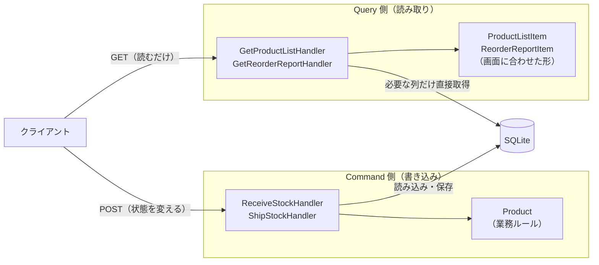

# 第9章 CQRS（コマンドクエリ責務分離）

[目次へ戻る](../../README.md) ｜ サンプル: [`samples/Part2/09-Cqrs`](../../samples/Part2/09-Cqrs/Inventory.Cqrs.WebApi)

## 9.1 CQRS とは

CQRS（Command Query Responsibility Segregation）は、Greg Young が広めたパターンで、
アプリの処理を次の2つにはっきり分けます。

| 種類 | 何をするか | 例 |
|---|---|---|
| **Command**（コマンド） | 状態を変える。結果のデータは返さない | 入庫する、出庫する |
| **Query**（クエリ） | データを読む。状態は一切変えない | 商品一覧を見る、発注レポートを見る |

元になったのは、Bertrand Meyer の **CQS（コマンドクエリ分離）** という「メソッドは、状態を変えるか値を返すか、どちらか一方だけにせよ」という原則です。
CQRS は、これをメソッド単位ではなく、**モデル（クラスの設計）単位** に広げたものです。

## 9.2 Bad コード：読み取りも書き込みも1つのモデルで

第8章のように業務ルールをしっかり持たせた `Product` 集約を、画面の表示にもそのまま使ったとします。

```csharp
// ❌ Bad: 一覧を表示したいだけなのに、集約を丸ごと読み込んでいる
public async Task<IReadOnlyList<ProductListItem>> GetProductListAsync()
{
    var products = await _repository.GetAllAsync();   // 入出庫履歴（Movements）も全部読み込まれる
    return products
        .Select(p => new ProductListItem(p.Code.Value, p.Name, p.Stock.Value, p.NeedsReorder ? "要発注" : "適正"))
        .ToList();
}
```

```csharp
// ❌ Bad: 帳票の都合で、集約に表示用のプロパティが増えていく
public sealed class Product : AggregateRoot
{
    ...
    public int Shortage => Math.Max(0, ReorderPoint.Value - Stock.Value);   // 発注レポート用
    public string StatusLabel => NeedsReorder ? "要発注" : "適正";          // 一覧画面用
    public DateTimeOffset? LastShippedAt => Movements.LastOrDefault(...)?.OccurredAt;  // 別の画面用
}
```

```csharp
// ❌ Bad: 画面が増えるたびに、リポジトリのメソッドも増えていく
public interface IProductRepository
{
    Task<Product?> FindAsync(ProductCode code);
    Task<IReadOnlyList<Product>> GetAllAsync();
    Task<IReadOnlyList<Product>> GetBelowReorderPointAsync();          // 発注レポート用
    Task<IReadOnlyList<Product>> GetPagedAsync(int page, int size);    // 一覧のページング用
    Task<IReadOnlyList<Product>> SearchByNameAsync(string keyword);    // 検索画面用
    ...
}
```

### 何に困るのか

- **読み取りが遅い**: 一覧に「コード・名前・在庫数」を出したいだけなのに、履歴まで含めた集約を全件読み込みます。商品が1万件、履歴が100万件あったら大変です。
- **業務ルールのモデルが、画面の都合で汚れる**: `StatusLabel` や `Shortage` は表示のためのもので、業務ルールではありません。集約が「業務ルールを守る場所」から「何でも置き場」になっていきます。
- **読み取りと書き込みで、求められるものが正反対**:

| | 書き込み（Command） | 読み取り（Query） |
|---|---|---|
| 大事なこと | ルールを必ず守ること | 速いこと、画面に合った形であること |
| 欲しいデータ | 1つの集約を丸ごと | 多くの行の、一部の列だけ |
| 頻度 | 少ない | 多い（一般に、読み取りのほうがずっと多い） |

1つのモデルで両方を満たそうとすると、どちらにとっても中途半端になります。

## 9.3 なぜこの仕組みにしたのか

正反対のものを1つで満たそうとするから無理が出る、それなら **分けてしまおう** というのが CQRS の考え方です。

- **Command 側**: 第7・8章と同じく、集約を読み込み、業務ルールを通してから保存する。ルールを守ることに集中する。
- **Query 側**: 集約やリポジトリを使わず、**画面に必要な列だけを、画面に合った形で直接取り出す**。業務ルールは通らない（状態を変えないので、守るべきルールがない）。

こうすると、集約は業務ルールだけを持つきれいな形を保てます。画面が増えても、Query を1つ足すだけで、集約にもリポジトリにも手を入れずに済みます。

## 9.4 構造



> **補足：データベースまで分けるかどうか**
> CQRS には、読み取り用と書き込み用で **データベースそのものを分ける** 本格的な形もあります。
> 書き込み用のデータベースが更新されたら、それを読み取り用のデータベース（検索エンジンや、集計済みのテーブルなど）に反映します。
> 読み取りの性能を大きく上げられる一方、反映までの時間差（結果整合性）を考える必要があり、仕組みがかなり複雑になります。
> この章のサンプルは、**同じデータベースを使い、コードの上だけで分ける** 手軽な形です。まずはこの形から始めるのがおすすめです。

## 9.5 サンプルコードの解説

```
Inventory.Cqrs.WebApi/
├── Domain/Product.cs                       業務ルール（Command 側だけが使う）
├── Infrastructure/InventoryDbContext.cs
├── Application/
│   ├── Abstractions.cs                     ICommandHandler / IQueryHandler
│   ├── Commands/
│   │   ├── ReceiveStock.cs                 Command とその処理
│   │   └── ShipStock.cs
│   └── Queries/
│       ├── GetProductList.cs               Query とその処理
│       └── GetReorderReport.cs
└── Program.cs
```

CQRS の考え方に集中するため、このサンプルは1つのプロジェクトの中でフォルダを分けています。第7章のように層ごとにプロジェクトを分けても構いません。

### 2種類のインターフェース

[`Application/Abstractions.cs`](../../samples/Part2/09-Cqrs/Inventory.Cqrs.WebApi/Application/Abstractions.cs)

```csharp
public interface ICommandHandler<in TCommand>
{
    Task HandleAsync(TCommand command, CancellationToken cancellationToken = default);   // 戻り値なし
}

public interface IQueryHandler<in TQuery, TResult>
{
    Task<TResult> HandleAsync(TQuery query, CancellationToken cancellationToken = default);  // 結果を返す
}
```

インターフェースの形そのもので「Command はデータを返さない」「Query は結果を返す」というルールを表しています。

### Command 側：業務ルールを通して保存する

[`Application/Commands/ShipStock.cs`](../../samples/Part2/09-Cqrs/Inventory.Cqrs.WebApi/Application/Commands/ShipStock.cs)

```csharp
public sealed record ShipStockCommand(string Code, int Quantity);

public sealed class ShipStockHandler(InventoryDbContext db) : ICommandHandler<ShipStockCommand>
{
    public async Task HandleAsync(ShipStockCommand command, CancellationToken cancellationToken = default)
    {
        var product = await db.Products.FindAsync(new object[] { command.Code }, cancellationToken)
            ?? throw new ProductNotFoundException(command.Code);

        product.Ship(command.Quantity);         // 業務ルールは Product に任せる
        await db.SaveChangesAsync(cancellationToken);
    }
}
```

- Command は「何をしてほしいか」を表すデータ（`record`）で、Handler がそれを処理します。
- 第7章のユースケースとほぼ同じですが、**結果のデータを返しません**。

### Query 側：画面に必要な形で直接取り出す

[`Application/Queries/GetReorderReport.cs`](../../samples/Part2/09-Cqrs/Inventory.Cqrs.WebApi/Application/Queries/GetReorderReport.cs)

```csharp
public sealed record ReorderReportItem(string Code, string Name, int Stock, int ReorderPoint, int Shortage);

public sealed class GetReorderReportHandler(InventoryDbContext db)
    : IQueryHandler<GetReorderReportQuery, IReadOnlyList<ReorderReportItem>>
{
    public async Task<IReadOnlyList<ReorderReportItem>> HandleAsync(GetReorderReportQuery query, CancellationToken cancellationToken = default) =>
        await db.Products
            .AsNoTracking()                                  // 変更を追跡しない＝読むだけ
            .Where(p => p.Stock <= p.ReorderPoint)
            .OrderByDescending(p => p.ReorderPoint - p.Stock)
            .Select(p => new ReorderReportItem(p.Code, p.Name, p.Stock, p.ReorderPoint, p.ReorderPoint - p.Stock))
            .ToListAsync(cancellationToken);
}
```

- **不足数（`Shortage`）は、`Product` クラスにはありません**。Query 側が、帳票の都合に合わせて自由に計算しています。9.2 の Bad コードのように、集約に表示用のプロパティを足す必要はありません。
- `Where` や `Select` は SQL に変換されてデータベースで実行されるので、必要な行・列だけが取り出されます。
- `AsNoTracking()` は、EF Core に「読み込んだオブジェクトの変更を見張らなくてよい」と伝えるものです。読み取りが速くなります。

### エンドポイント：GET は Query、POST は Command

[`Program.cs`](../../samples/Part2/09-Cqrs/Inventory.Cqrs.WebApi/Program.cs)

```csharp
// Query: GET。データを返すだけで、状態は変えない
app.MapGet("/reports/reorder", (IQueryHandler<GetReorderReportQuery, IReadOnlyList<ReorderReportItem>> handler, CancellationToken ct) =>
    handler.HandleAsync(new GetReorderReportQuery(), ct));

// Command: POST。状態を変えるだけで、データは返さない（204 No Content）
app.MapPost("/products/{code}/ship", async (string code, StockRequest request, ICommandHandler<ShipStockCommand> handler, CancellationToken ct) =>
{
    await handler.HandleAsync(new ShipStockCommand(code, request.Quantity), ct);
    return Results.NoContent();
});
```

HTTP の GET（安全な読み取り）と POST（状態の変更）の区別とも、うまく対応しています。

### 動かしてみる

```bash
dotnet run --project samples/Part2/09-Cqrs/Inventory.Cqrs.WebApi
```

[`Inventory.Cqrs.WebApi.http`](../../samples/Part2/09-Cqrs/Inventory.Cqrs.WebApi/Inventory.Cqrs.WebApi.http) から、`GET /reports/reorder` を送ってみてください。
P-001 を 80 個出庫してからもう一度送ると、発注レポートに P-001 が加わります。

> **補足：MediatR などのライブラリ**
> .NET では、Command / Query を Handler に振り分けるために MediatR というライブラリがよく使われてきました。
> このサンプルのように、小さなインターフェースを自分で定義するだけでも CQRS は実現できます。ライブラリを使うかどうかは、ライセンスや必要な機能を確かめてから決めてください。

## 9.6 メリット・デメリットと向いている場面

| メリット | デメリット |
|---|---|
| 集約が業務ルールだけを持つ形に保てる | Command と Query でクラスが分かれ、ファイルが増える |
| 読み取りを、画面ごとに最適な形・速さにできる | Query 側は業務ルールを通らないので、計算の重複（「要発注」の判定など）が起きうる |
| 画面を足しても、書き込み側に影響しない | データベースまで分けると、結果整合性への対応が必要になり大幅に複雑になる |

**向いている場面**: 読み取りの種類（画面・帳票・検索）が多いアプリ。読み取りと書き込みで、量や性能の要求が大きく違うアプリ。
業務ルールが少なく、画面と保存内容がほぼ同じ形のアプリでは、分ける効果はあまりありません。

---

[← 前の章：第8章 DDD](08-ddd.md) ｜ [次の章：第10章 Vertical Slice Architecture →](10-vertical-slice.md)
