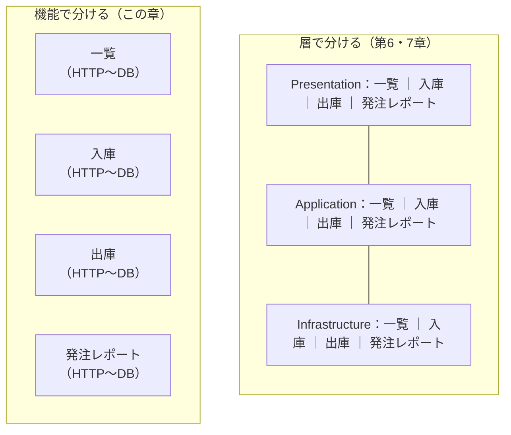
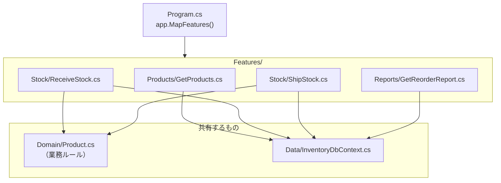

# 第10章 Vertical Slice Architecture

[目次へ戻る](../../README.md) ｜ サンプル: [`samples/Part2/10-VerticalSlice`](../../samples/Part2/10-VerticalSlice/Inventory.VerticalSlice.WebApi)

## 10.1 Vertical Slice Architecture とは

Vertical Slice Architecture（垂直スライス）は、Jimmy Bogard が広めた構成で、
コードを **層（横の切れ目）ではなく、機能（縦の切れ目）でまとめます**。



1つの機能について、HTTP の受け口からデータベースの操作までを **1つのまとまり（スライス）** に入れます。

## 10.2 Bad コード：機能を1つ足すだけで、全部の層を触る

第7章のクリーンアーキテクチャのサンプルに、「発注レポート」という機能を足すことを考えます。必要な変更は次のとおりです。

```diff
 Inventory.Clean.Application/
   Abstractions/IProductRepository.cs
+    Task<IReadOnlyList<Product>> GetBelowReorderPointAsync(...);   // ① インターフェースにメソッド追加
   Products/
+    ReorderReportItem.cs                                           // ② 応答用の DTO を追加
+    GetReorderReportUseCase.cs                                     // ③ ユースケースを追加

 Inventory.Clean.Infrastructure/
   Persistence/EfProductRepository.cs
+    public async Task<IReadOnlyList<Product>> GetBelowReorderPointAsync(...) { ... }  // ④ 実装を追加

 Inventory.Clean.WebApi/
   Program.cs
+    builder.Services.AddScoped<GetReorderReportUseCase>();         // ⑤ DI に登録
+    app.MapGet("/reports/reorder", ...);                           // ⑥ エンドポイントを追加

 Part2.Tests/
   CleanUseCaseTests.cs
+    （テスト用の InMemoryProductRepository にも GetBelowReorderPointAsync を実装）  // ⑦
```

**3つのプロジェクトにまたがる、7か所の変更** です。

### 何に困るのか

- **1つの機能のコードが散らばる**: 「発注レポートはどう動いているの？」を知るには、3つのプロジェクトの5つのファイルを行ったり来たりする必要があります。
- **関係ない機能まで影響を受ける**: `IProductRepository` にメソッドを足すと、それを実装しているすべてのクラス（テスト用の偽物も含む）を直す必要があります。
- **共有のクラスが太る**: 機能が増えるたびに `IProductRepository` のメソッドが増え、第9章の Bad コードのような状態になります。
- **同時に作業するとぶつかる**: 複数の人が別々の機能を作っていても、同じ `IProductRepository.cs` や `Program.cs` を編集するので、変更が衝突しやすくなります。

アプリへの変更の多くは「機能を足す・直す」です。それなのに、層で分けた構成では、1つの機能の変更がすべての層に広がってしまいます。

## 10.3 なぜこの仕組みにしたのか

Vertical Slice Architecture の考え方は、**一緒に変わるものは、一緒に置く** です。

- 発注レポートの URL・応答の形・データベースの問い合わせは、いつも一緒に変わる → 1つのファイルにまとめる
- 機能ごとに独立しているので、**発注レポートの変更が、入庫や出庫のコードに影響しない**
- 機能ごとに、ちょうどよい書き方を選べる。単純な一覧は DbContext から直接読み、ルールが大事な出庫はエンティティを通す

これは第9章の CQRS とも相性がよく、各スライスが自然に「1つの Command」か「1つの Query」になります。

ただし、**何もかも機能ごとに書くわけではありません**。在庫不足のチェックのように、複数の機能で共有すべき業務ルールは、機能フォルダの外（`Domain/`）に置きます。

## 10.4 構造



```
Inventory.VerticalSlice.WebApi/
├── Domain/Product.cs               複数の機能で共有する業務ルール
├── Data/InventoryDbContext.cs      共有するデータベース設定
├── Features/
│   ├── Products/GetProducts.cs     機能: 商品一覧
│   ├── Stock/ReceiveStock.cs       機能: 入庫
│   ├── Stock/ShipStock.cs          機能: 出庫
│   ├── Reports/GetReorderReport.cs 機能: 発注レポート
│   └── FeatureEndpoints.cs         全機能の登録
└── Program.cs
```

## 10.5 サンプルコードの解説

### 1つの機能 = 1つのファイル

[`Features/Reports/GetReorderReport.cs`](../../samples/Part2/10-VerticalSlice/Inventory.VerticalSlice.WebApi/Features/Reports/GetReorderReport.cs)

```csharp
public static class GetReorderReport
{
    // 応答の形
    public sealed record Response(string Code, string Name, int Stock, int ReorderPoint, int Shortage);

    // URL
    public static void MapEndpoint(IEndpointRouteBuilder app) =>
        app.MapGet("/reports/reorder", HandleAsync);

    // 処理
    private static async Task<List<Response>> HandleAsync(InventoryDbContext db, CancellationToken ct) =>
        await db.Products
            .AsNoTracking()
            .Where(p => p.Stock <= p.ReorderPoint)
            .OrderByDescending(p => p.ReorderPoint - p.Stock)
            .Select(p => new Response(p.Code, p.Name, p.Stock, p.ReorderPoint, p.ReorderPoint - p.Stock))
            .ToListAsync(ct);
}
```

発注レポートについて知りたいことは、すべてこのファイルにあります。
10.2 の Bad コードと比べると、この機能の追加に必要だった変更は次の2つだけです。

```diff
+ Features/Reports/GetReorderReport.cs     // ① ファイルを追加
  Features/FeatureEndpoints.cs
+     GetReorderReport.MapEndpoint(app);   // ② 1行追加
```

`Response` を `GetReorderReport` の中に入れ子で定義しているのもポイントです。
ほかの機能にも `Response` という名前の型がありますが、`GetReorderReport.Response` と `GetProducts.Response` は別の型なので、ぶつかりません。**応答の形を機能ごとに自由に変えられます**。

### ルールが大事な機能は、共有のドメインを使う

[`Features/Stock/ShipStock.cs`](../../samples/Part2/10-VerticalSlice/Inventory.VerticalSlice.WebApi/Features/Stock/ShipStock.cs)

```csharp
private static async Task<IResult> HandleAsync(string code, Request request, InventoryDbContext db, CancellationToken ct)
{
    var product = await db.Products.FindAsync(new object[] { code }, ct);
    if (product is null)
        return Results.NotFound(new { error = $"商品 {code} が見つかりません。" });

    product.Ship(request.Quantity);   // 在庫不足のチェックは Domain の Product に任せる
    await db.SaveChangesAsync(ct);

    return Results.Ok(new Response(product.Code, product.Stock));
}
```

出庫の業務ルールは、入庫や棚卸しなど他の機能でも守られる必要があるので、[`Domain/Product.cs`](../../samples/Part2/10-VerticalSlice/Inventory.VerticalSlice.WebApi/Domain/Product.cs) に置いて共有しています。
一方、「出庫 API の応答に何を含めるか」はこの機能だけの都合なので、スライスの中に書いています。

### リポジトリやインターフェースがない理由

このサンプルの各スライスは、`IProductRepository` を通さず `InventoryDbContext` を直接使っています。
第7章では「業務ロジックがデータベースに依存するのはよくない」と学びましたが、ここでは次のように考えます。

- 業務ルールそのもの（`Product`）は、データベースに依存していない
- スライスの中の「取り出して、ルールを呼んで、保存する」という手順は、その機能だけのもので、ほかから再利用されない
- そのため、インターフェースを挟んでも得るものが少なく、ファイルが増えるだけになる

もちろん、外部の Web API を呼ぶ処理など、テストで差し替えたいものがあれば、そのスライスの中でインターフェースを使えばよいのです。**機能ごとに、必要な分だけ抽象化する** のが Vertical Slice の考え方です。

### 全機能の登録

[`Features/FeatureEndpoints.cs`](../../samples/Part2/10-VerticalSlice/Inventory.VerticalSlice.WebApi/Features/FeatureEndpoints.cs)・[`Program.cs`](../../samples/Part2/10-VerticalSlice/Inventory.VerticalSlice.WebApi/Program.cs)

```csharp
public static void MapFeatures(this IEndpointRouteBuilder app)
{
    GetProducts.MapEndpoint(app);
    ReceiveStock.MapEndpoint(app);
    ShipStock.MapEndpoint(app);
    GetReorderReport.MapEndpoint(app);
}
```

`Program.cs` は `app.MapFeatures()` を呼ぶだけです。

### 動かしてみる

```bash
dotnet run --project samples/Part2/10-VerticalSlice/Inventory.VerticalSlice.WebApi
```

[`Inventory.VerticalSlice.WebApi.http`](../../samples/Part2/10-VerticalSlice/Inventory.VerticalSlice.WebApi/Inventory.VerticalSlice.WebApi.http) からリクエストを送れます。

## 10.6 クリーンアーキテクチャとの使い分け

| | クリーンアーキテクチャ | Vertical Slice |
|---|---|---|
| コードのまとめ方 | 層ごと | 機能ごと |
| 機能追加で触る場所 | 全部の層 | ほぼ1か所 |
| 抽象化（インターフェース） | 層の境界には必ず入れる | 必要な機能にだけ入れる |
| 業務ルールの共有 | Domain 層に集める | 共有すべきものだけ外に出す |
| 向いているアプリ | 業務ルールが多く、技術の差し替えが見込まれる | 機能の数が多く、機能ごとの独立性が高い |

両者は対立するものではありません。たとえば、**Domain と Infrastructure はクリーンアーキテクチャのように分け、Application 層の中を機能ごとのフォルダにする** という組み合わせもよく使われます。

## 10.7 メリット・デメリットと向いている場面

| メリット | デメリット |
|---|---|
| 1つの機能のコードが1か所にまとまり、読みやすい | 機能をまたいだ重複が起きやすい（共有するかどうかの判断が必要） |
| 機能の追加・変更が、ほかの機能に影響しにくい | 全体の決まりがゆるいので、チーム内で書き方がばらつきやすい |
| 機能ごとに最適な書き方を選べる | 業務ルールが複雑なアプリでは、ドメインの設計（第8章）が別途必要 |

**向いている場面**: 機能（画面や API）の数が多く、それぞれが比較的独立している Web API や業務アプリ。複数人で並行して機能を開発するチーム。

---

[← 前の章：第9章 CQRS](09-cqrs.md) ｜ [次の章：第2部まとめ →](99-summary.md)
