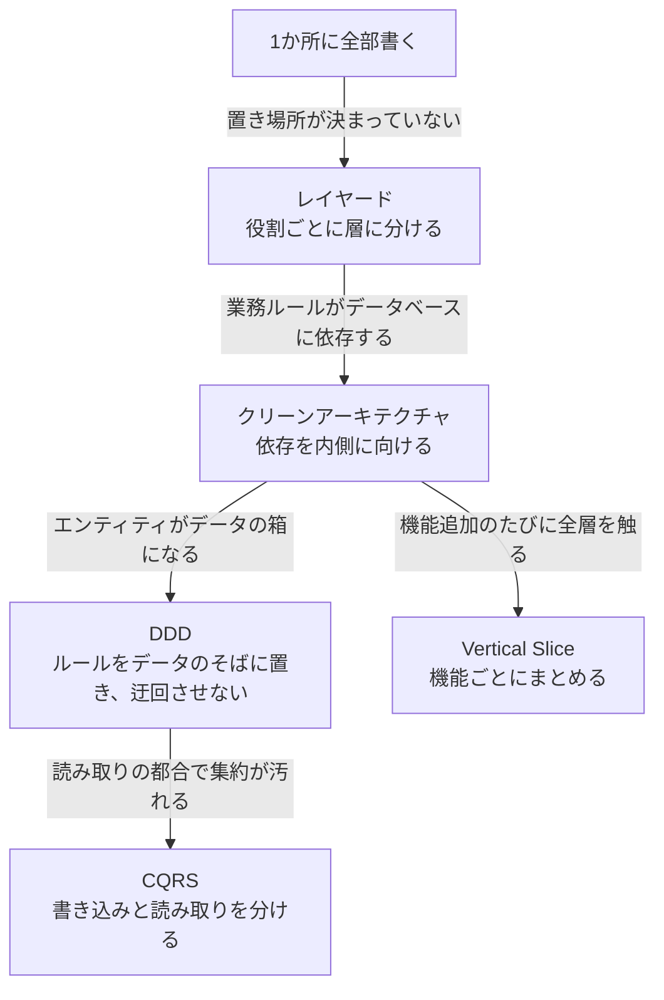
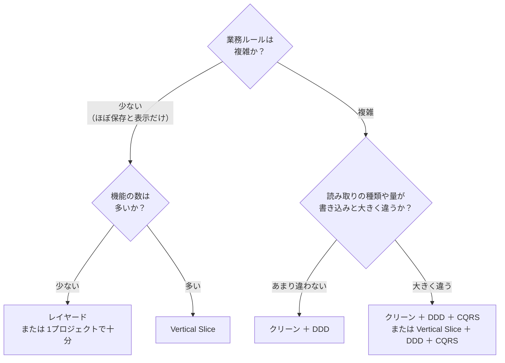
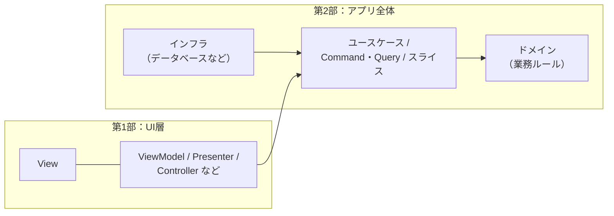

# 第2部まとめ：アプリ全体のパターンの比較と選び方

[目次へ戻る](../../README.md)

## パターンは「前のパターンの困りごと」から生まれた

## 比較表

| | レイヤード | クリーン | DDD | CQRS | Vertical Slice |
|---|---|---|---|---|---|
| 何を決めるものか | 層の分け方 | 依存の向き | ドメインの作り方 | 読み書きの分け方 | コードのまとめ方 |
| 業務ルールの置き場所 | 業務ロジック層のサービス | Domain のエンティティ | 集約・値オブジェクト | Command 側のエンティティ | 共有の Domain |
| データベースなしでのテスト | 難しい | できる | できる | Command 側は工夫が要る | 工夫が要る |
| 機能追加で触る場所 | 全層 | 全層 | 主に Domain | Command か Query の片方 | ほぼ1か所 |
| 学ぶコスト | 低 | 中 | 高 | 中 | 低〜中 |

## 組み合わせて使う

第2部の5つは、どれか1つを選ぶものではありません。**それぞれ別のことを決めている** ので、組み合わせて使えます。

| 組み合わせ | よくある形 |
|---|---|
| クリーン ＋ DDD | Domain 層を DDD の集約・値オブジェクトで作る（第8章のサンプルがこれ） |
| クリーン ＋ CQRS | Application 層を Command と Query に分ける |
| Vertical Slice ＋ CQRS | 各スライスが1つの Command か Query になる（第10章のサンプルがこれ） |
| Vertical Slice ＋ DDD | 業務ルールは DDD の集約として共有し、それ以外は機能ごとに書く |

## どれを選べばよいか

いちばん大事なのは、**アプリの性質に合った重さを選ぶ** ことです。

迷ったときは、次のことを覚えておいてください。

- **最初から重い構成にしない**: 小さなアプリに4つのプロジェクトと大量のインターフェースを用意すると、変更のたびに手間がかかるだけです。必要になったときに分けられるよう、**依存の向きだけは最初から意識しておく** のが現実的です。
- **パターンの名前より、解決したい問題を見る**: 各章の Bad コードのような困りごとが実際に起きているか、起きそうかで判断します。困りごとがないのにパターンを入れても、得るものはありません。
- **チームが理解できることも大事**: どんなによい構成でも、チームの全員が理解して守れなければ、すぐに崩れてしまいます。

## 第1部と第2部のつながり

第1部の UI パターンと、第2部の全体のパターンは、アプリの中で次のように組み合わさります。

たとえば WPF のアプリなら、「MVVM の ViewModel が、クリーンアーキテクチャのユースケースを呼び出す」という形になります。
第1部のパターンで **画面とロジックを分け**、第2部のパターンで **ロジックとデータベースを分ける** ことで、どこを変更しても影響が広がりにくい、育てやすいアプリになります。

---

[← 前の章：第10章 Vertical Slice Architecture](10-vertical-slice.md) ｜ [目次へ戻る](../../README.md)
